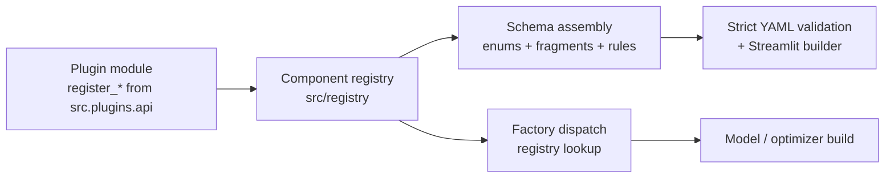

# How to Make a Plugin

A plugin adds new components — mixers, optimizers, norms, activations, residual
strategies, positional encodings or token embeddings — **without touching the
core dispatch code or the JSON schema by hand**. This guide walks through the
model end to end: from a single local file to a distributable package.

- Reference implementation: [`examples/plugins/window_mixer.py`](examples/plugins/window_mixer.py)
- Working preset: [`configs/examples/plugin_window_mixer.yaml`](configs/examples/plugin_window_mixer.yaml)
- Architecture and assembled-schema details: [`docs/architecture.md`](docs/architecture.md) §4
- Installation of the core and extras: [`INSTALL.md`](INSTALL.md)

---

## 1. How it works



1. Your module calls a **`register_*` helper** from `src.plugins.api`. That
   creates a frozen `ComponentSpec` (name, lazy builder, parameter-schema
   fragment, runtime defaults, capability flags, bilingual description).
2. The **registry** stores the spec.
3. `resolve_schema()` **assembles** the schema: your name is added to the
   relevant enum, your parameter fragment becomes
   `model.attention.<name>` (or the optimizer/PE equivalent), and the optimizer
   prefix rules are regenerated. Validation stays strict
   (`additionalProperties: false`).
4. The family factories dispatch through the same registry as the built-ins, so
   your component is used by `HybridLayer`, `build_optimizer`, `get_norm`, etc.
5. The **loader** populates the registry from three layers:
   - installed `frankenstein.plugins` **entry points** (failures are logged and
     skipped),
   - the config's top-level **`plugins:`** list (failures are hard errors),
   - the in-repo **built-ins**.

Nothing else is required: no schema edit, no `by_optimizer` entry, no
`if/then` rule, no flattening table, no dataclass field.

---

## 2. Five-minute local plugin (a mixer)

Create `plugins/window_mixer.py`:

```python
"""Local-window self-attention example plugin."""
from __future__ import annotations

import math

import torch
import torch.nn as nn
import torch.nn.functional as F

try:  # flat sys.path layout fallback (src/ on sys.path)
    from src.plugins.api import register_mixer
except ImportError:
    from plugins.api import register_mixer


class LocalWindowAttention(nn.Module):
    def __init__(self, config, pos_encoder=None, params=None):
        super().__init__()
        self.hidden_size = int(config.hidden_size)
        self.num_heads = int(config.num_heads)
        self.head_dim = self.hidden_size // self.num_heads
        self.window = int(params.window_size if params is not None else 128)
        self.causal = str(getattr(config, "mode", "encoder")) == "decoder"
        self.qkv = nn.Linear(self.hidden_size, 3 * self.hidden_size, bias=False)
        self.out_proj = nn.Linear(self.hidden_size, self.hidden_size, bias=False)
        self.dropout = nn.Dropout(float(getattr(config, "dropout", 0.0) or 0.0))

    def forward(self, x, logical_layer_idx=None, pos_encoder=None):
        b, s, _ = x.shape
        q, k, v = self.qkv(x).view(b, s, 3, self.num_heads, self.head_dim).permute(2, 0, 3, 1, 4)
        scores = (q @ k.transpose(-2, -1)) / math.sqrt(self.head_dim)
        pos = torch.arange(s, device=x.device)
        mask = (pos[:, None] - pos[None, :]).abs() > self.window
        if self.causal:
            mask = mask | (pos[None, :] > pos[:, None])
        weights = self.dropout(F.softmax(scores.masked_fill(mask, float("-inf")), dim=-1))
        return self.out_proj((weights @ v).transpose(1, 2).reshape(b, s, self.hidden_size))


register_mixer(
    name="local_window",
    builder=LocalWindowAttention,          # callable: survives file-path loading
    description="Local windowed self-attention (example plugin).",
    description_es="Autoatención local por ventana (plugin de ejemplo).",
    params_schema={
        "type": "object",
        "additionalProperties": False,
        "properties": {
            "window_size": {"type": "integer", "minimum": 1, "default": 128},
        },
    },
    defaults={"window_size": 128},
    needs_pos_encoder=True,
    cache=None,                            # no KV-cache branch: full recompute (never fatal)
)
```

Use it from a YAML:

```yaml
plugins:
  - ./plugins/window_mixer.py

model:
  dims:
    vocab_size: 50000
    hidden_size: 768
    num_loops: 1
    num_layers: 4
    num_heads: 12
    layer_pattern: [local_window, local_window, standard, standard]
  attention:
    local_window:
      window_size: 128
training:
  task: mlm
```

Validate + smoke-test without a dataset:

```bash
python - <<'PY'
import torch
from src.training.config_loader import load_training_config
from src.engine import build_model

loaded = load_training_config("my_plugin_config.yaml")
model = build_model(loaded.model_class, loaded.model_config).eval()
out = model(torch.randint(0, 50000, (2, 32)))
print(out.shape)  # torch.Size([2, 32, 50000])
PY
```

The shipped example does exactly this — compare with
`examples/plugins/window_mixer.py` and
`configs/examples/plugin_window_mixer.yaml`.

---

## 3. Builder contracts per family

| Family | Builder signature | Extra contract |
|---|---|---|
| Mixer | `builder(config, pos_encoder=None, params=None) -> nn.Module` | `forward(x, logical_layer_idx=None, pos_encoder=None)`; return `(B, S, H)` |
| Optimizer | class `(param_groups, **kwargs)` | `torch.optim.Optimizer` subclass; kwargs come from `param_bindings` |
| Norm | `builder(config, params) -> nn.Module` | receives only the fragment-declared knobs |
| Activation | `builder(config, params, dim=None) -> nn.Module` | `params` is the raw `ffn.activation_config` dict |
| Residual | `builder(config, params) -> ResidualBase` | implement `set_streams(n)`; factory sets `use_fixed_softmax` |
| Positional encoding | `builder(config, params) -> nn.Module` | `forward(x, logical_layer_idx=0, position_offset=0)` |
| Token embedding | `builder(config, params) -> nn.Module` | expose `embedding_table()` if it has a materializable table (export path) |

> **Mixers that declare `training_free=True`** must also implement
> `mixer.dense_forward(...)`: `HybridLayer` substitutes the dense path in
> training mode (`fasa`/`sparge` pattern).

---

## 4. Registering the other families

### 4.1 Optimizer

```python
import torch
from torch.optim import Optimizer
from src.plugins.api import register_optimizer
from src.registry.spec import ParamBinding
from src.registry.coercions import as_float

class SignSGD(Optimizer):
    def __init__(self, params, momentum: float = 0.0):
        super().__init__(params, dict(momentum=momentum))
        self.momentum = momentum

    @torch.no_grad()
    def step(self, closure=None):
        loss = closure() if closure is not None else None
        for group in self.param_groups:
            for p in group["params"]:
                if p.grad is None:
                    continue
                p.add_(p.grad.sign(), alpha=-group["lr"])
        return loss

register_optimizer(
    name="sign_sgd",
    builder=SignSGD,
    description="Sign-SGD example plugin.",
    description_es="Plugin de ejemplo Sign-SGD.",
    param_bindings={"momentum": ParamBinding(as_float, 0.0)},
    group_policy="sgd",          # route lr/wd only (no betas/eps)
    sbert_allowed=True,
)
```

YAML:

```yaml
training:
  optimizer:
    optimizer_class: sign_sgd
    parameters:
      sign_sgd-lr_attention: 1e-3
      sign_sgd-lr_ffn: 1e-3
      sign_sgd-momentum: 0.9
```

`param_bindings` replaces the old per-optimizer `if/elif` branch: each key is a
constructor keyword, with a coercion helper and a default. Use
`custom_build(spec, groups, scoped, kwargs)` for genuinely special constructors.

### 4.2 Normalization

```python
import torch.nn as nn
from src.plugins.api import register_norm

class ScaledLayerNorm(nn.LayerNorm):
    pass

def build_scaled(config, params):
    return ScaledLayerNorm(int(config.hidden_size))

register_norm(
    name="scaled_layer_norm",
    builder=build_scaled,          # callable works for file-path and installed plugins
    description="LayerNorm example plugin.",
    description_es="Plugin de ejemplo LayerNorm.",
    # Optional: declare norm-block knobs. Omit the fragment entirely if the
    # norm takes no parameters (the factory binds only declared keys).
    params_schema={
        "type": "object",
        "additionalProperties": False,
        "properties": {
            "partial_ratio": {"type": "number", "default": 0.0625},
            "flashnorm_partial_ratio": {"type": "number", "default": 0.0},
        },
    },
    defaults={"partial_ratio": 0.0625, "flashnorm_partial_ratio": 0.0},
)
```

Set `supports_ffn_fusion=True` only if the norm can be folded into the FFN's
first projection the way FlashNorm is.

### 4.3 Activation

```python
import torch.nn as nn
from src.plugins.api import register_activation

class Square(nn.Module):
    def forward(self, x):
        return x * x


def build_square(config, params, dim=None):
    return Square()


register_activation(
    name="square",
    builder=build_square,
    description="Elementwise square example plugin.",
    description_es="Plugin de ejemplo cuadrado elemento a elemento.",
)
```

GLU variants set `is_glu=True`; `get_activation()` rejects them and
`GatedFFN` handles them.

### 4.4 Residual strategy

The encoder merges the standard residual itself; a **custom** residual is only
invoked when it declares `is_attn_res = True`, and the encoder then calls
`set_embedding(x)`, `register_state(num_layers=...)`, `reset_state()` and
`forward(layer_idx, layer_output)` (`set_embedding` defaults to a no-op in
`ResidualBase`; override it to seed a source list).

```python
import torch
from src.model.residuals.base import ResidualBase
from src.plugins.api import register_residual


class MeanResidual(ResidualBase):
    """Replace the residual stream with the mean of all layer outputs."""

    def __init__(self, hidden_size):
        super().__init__(hidden_size)
        self.is_attn_res = True
        self._outputs = []

    def reset_state(self):
        self._outputs = []

    def forward(self, layer_idx, layer_output):
        self._outputs.append(layer_output)
        return torch.stack(self._outputs, dim=0).mean(dim=0)


register_residual(
    name="mean",
    builder=lambda config, params: MeanResidual(int(config.hidden_size)),
    description="Mean-of-layer-outputs residual example plugin.",
    description_es="Plugin de ejemplo de residual con media de salidas de capa.",
)
```

Residual shapes follow `(B, S, D)` or the mHC `(B, S, n, D)` convention.

### 4.5 Positional encoding

```python
import torch
import torch.nn as nn
from src.plugins.api import register_posenc

class ZeroPE(nn.Module):
    def forward(self, x, logical_layer_idx=0, position_offset=None):
        return x

register_posenc(
    name="zero_pe",
    builder=lambda config, params: ZeroPE(),
    description="Identity positional encoding example plugin.",
    description_es="Plugin de ejemplo de codificación posicional identidad.",
    params_key="zero_pe",   # reads model.positional_encoding_parameters.zero_pe
)
```

Rotary encodings must operate on the per-head dimension; ALiBi/BAM-style
encodings inject additive score biases.

### 4.6 Token embedding

```python
import torch.nn as nn
from src.plugins.api import register_embedding

register_embedding(
    name="tiny",
    builder=lambda config, params: nn.Embedding(int(config.vocab_size), int(config.hidden_size)),
    description="Standard-table embedding example plugin.",
    description_es="Plugin de ejemplo de embedding con tabla estándar.",
)
```

Select it with `model.embedding.type: tiny`.

---

## 5. Parameter fragments and defaults

- `params_schema` is a **strict** JSON-Schema object
  (`"additionalProperties": false`). It becomes the validated
  `model.attention.<name>` (or the PE equivalent) block and the source of the
  Streamlit controls.
- **Use inline mappings in plugins.** String fragment references such as
  `"schema/_model/_attention_latent.yaml#/properties/mla"` resolve relative to
  the *core* `src/` tree, which a plugin does not ship.
- `defaults` are the runtime values used when the YAML omits a key. If the
  fragment also declares a `default`, the two must agree (the consistency gate
  checks it).
- Bilingual `description` / `description_es` are **required**; both are part of
  the spec contract.
- Inside a component read knobs through the bound namespace:

  ```python
  self.window = int(params.value("window_size", 128))  # None == absent
  ```

  `params.<key>` also works; `params.value(key, default)` treats an explicit
  `null` as absent.

---

## 6. Distributable plugin package

```
my-frankenstein-plugin/
├── pyproject.toml
└── src/
    └── my_plugin/
        ├── __init__.py
        ├── window.py
        └── register.py
```

`pyproject.toml`:

```toml
[project]
name = "my-frankenstein-plugin"
version = "0.1.0"
requires-python = ">=3.10"
dependencies = ["frankenstein-transformer>=1.8"]   # first release with src.registry

[project.entry-points."frankenstein.plugins"]
my_plugin = "my_plugin.register:register"

[build-system]
requires = ["hatchling"]
build-backend = "hatchling.build"

[tool.hatch.build.targets.wheel]
packages = ["src/my_plugin"]
```

`src/my_plugin/register.py`:

```python
from .window import LocalWindowAttention
from src.plugins.api import register_mixer

def register() -> None:
    register_mixer(
        name="local_window",
        builder="my_plugin.window:LocalWindowAttention",
        description="Local windowed self-attention.",
        description_es="Autoatención local por ventana.",
        params_schema={
            "type": "object",
            "additionalProperties": False,
            "properties": {"window_size": {"type": "integer", "minimum": 1, "default": 128}},
        },
        defaults={"window_size": 128},
    )
```

Install and verify:

```bash
pip install -e ./my-frankenstein-plugin

python -c "
from src.plugins.loader import load_entry_point_plugins
from src.registry import registry, ComponentFamily
load_entry_point_plugins()
print('local_window' in registry.names(ComponentFamily.MIXER))
"
```

Notes:

- The entry point must resolve to a **zero-argument callable** that performs
  the registration (the loader calls it).
- Registration must be **idempotent** (the loader may run more than once);
  identical re-registration is a no-op.
- **Do not shadow a built-in name** (`standard`, `adamw`, `rms_norm`, …):
  re-registering a different spec under an existing name raises
  `DuplicateComponentError`.
- Prefer lazy `"module:attribute"` builders for installed packages; use
  callables for single-file, path-loaded plugins (the file loader assigns a
  synthetic module name, so a `"module:Class"` string would not resolve).
  Callables work for both, so they are the safest default while developing.
- The registry ships in the first release after `v1.7.0`; until that is
  published, install the core from the same checkout
  (`pip install -e ../frankenstein-transformer`) and keep the dependency
  unpinned or pin to that local version.

---

## 7. Testing your plugin

A minimal pytest module:

```python
import torch
import pytest
from src.registry import ComponentFamily, registry
from src.registry.errors import UnknownComponentError
from src.training.config_loader import load_training_config


def test_spec_registered():
    from my_plugin.register import register
    register()
    assert "local_window" in registry.names(ComponentFamily.MIXER)


def test_schema_validates(tmp_path):
    cfg = tmp_path / "cfg.yaml"
    cfg.write_text(
        """
plugins: [my_plugin]
model:
  dims:
    vocab_size: 128
    hidden_size: 64
    num_layers: 1
    num_loops: 1
    num_heads: 4
    layer_pattern: [local_window]
  attention:
    local_window: {window_size: 16}
training:
  task: mlm
"""
    )
    loaded = load_training_config(str(cfg))
    assert loaded.model_config.attention["local_window"]["window_size"] == 16


def test_forward_backward():
    from src.model.config import FrankensteinModelConfig
    from src.engine import build_model

    config = FrankensteinModelConfig.from_dict(
        {
            "dims": {
                "vocab_size": 128, "hidden_size": 64, "num_layers": 1,
                "num_loops": 1, "num_heads": 4, "layer_pattern": ["local_window"],
            },
            "attention": {"local_window": {"window_size": 16}},
        }
    )
    model = build_model("frankenstein_text_encoder", config)
    logits = model(torch.randint(0, 128, (2, 8)))
    logits.mean().backward()
    assert torch.isfinite(logits).all()
```

Checks worth including:

- assembled schema contains the name in the right enum;
- invalid fragment keys are rejected by validation;
- component builds and forwards/backwards;
- with `cache=None`, `src.model.cache.capabilities.is_cacheable(name)` is
  `False` (inference falls back, never fails);
- `qk_norm_supported` is truthful if you enable `norm.qk_norm`.

---

## 8. Capability flags (declare them honestly)

| Flag | Meaning | Effect |
|---|---|---|
| `cache` + `cache_implemented` | Exact incremental branch exists and is parity-tested | Only then does KV-cache decoding use your mixer; otherwise full recompute |
| `training_free` | Sparse path is eval-only; training uses `dense_forward` | `HybridLayer` substitutes dense attention in training |
| `qk_norm_supported` / `qk_clip_supported` | Supports QK-norm / QuacK / QK-Clip | Enabling `norm.qk_norm` with an unsupported mixer rejects the config |
| `needs_pos_encoder` | Default for `positional_encoding_parameters.use_pe.<name>` | Controls the generated toggle |
| `supports_ffn_fusion` | Norm can fold into the FFN projection | Enables the FlashNorm-style fused path |
| `is_glu` | Gated FFN variant | `get_activation()` rejects it; `GatedFFN` builds it |
| `closure_based` / `requires_grad_accum_one` / `sbert_allowed` | Optimizer runtime requirements | Loader/trainer validation |

---

## 9. Pitfalls

1. **Relative `plugins:` paths** resolve against the **working directory**, not
   the YAML file. Use `./plugins/x.py` from the repo root or an absolute path.
2. **Fragment references** (`"schema/...#/..."`) point into the core `src/`
   tree; plugins must use inline dicts.
3. **Path-loaded files get a synthetic module name**; use callable builders
   there instead of `"module:Class"` strings.
4. **Entry-point failures are silent by design** (logged as warnings). If your
   plugin does not appear, check the log and run
   `load_entry_point_plugins()` explicitly while debugging.
5. **Config-declared plugin failures are hard errors** (`PluginLoadError`) —
   intentional, because the config asked for it explicitly.
6. **Estimator/paper coverage**: plugin components are not in the website
   parameter estimator or the paper annexes. That is documentation scope, not a
   functional limitation.
7. **No shadowing**: built-in names are reserved.
8. **Schema is assembled before validation**: a component cannot be used unless
   its plugin is installed or listed under `plugins:`.

---

## 10. Checklist

- [ ] Module implements the family contract (signature + forward/step).
- [ ] `register_*` call with a valid snake_case name, callable/lazy builder,
      strict inline `params_schema`, runtime `defaults`, bilingual
      descriptions.
- [ ] Capability flags reflect reality (`cache`, `training_free`,
      `qk_norm_supported`, `is_glu`, `supports_ffn_fusion`, …).
- [ ] Example config (or `plugins:` entry) added.
- [ ] Schema validates; component builds; forward/backward passes.
- [ ] For a package: entry point declared, registration idempotent, version
      constraint on `frankenstein-transformer`.
- [ ] Run the gates:
      `uv run --extra cpu --extra train python -m pytest tests/ -q`.
