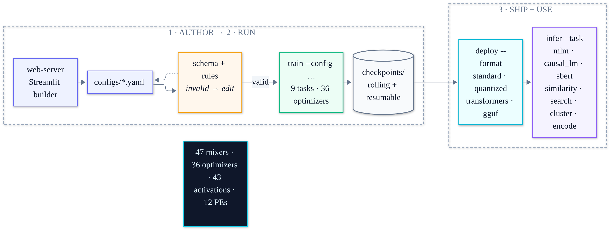
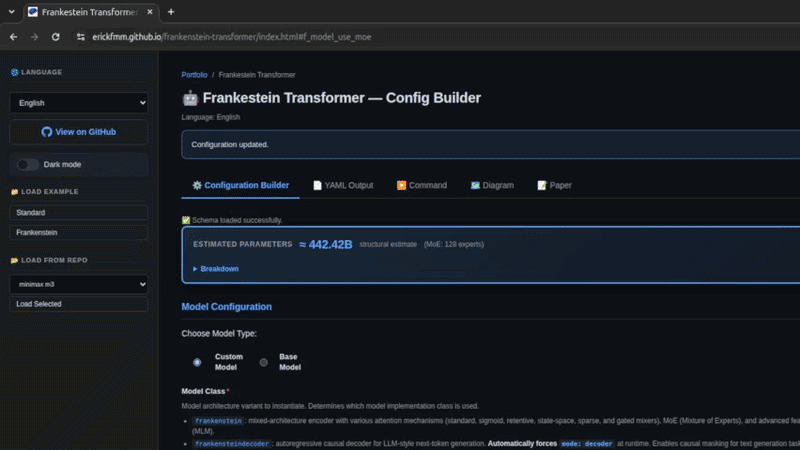

# Frankenstein Transformer

[](https://www.python.org/downloads/)
[](https://pytorch.org/)
[](LICENSE)
[](https://github.com/erickfmm/frankenstein-transformer/actions)
[](https://pypi.org/project/frankenstein-transformer/)
[](https://frankenstein-transformer.readthedocs.io/en/latest/)

**See [frankenstein-transformer](https://erickfmm.github.io/frankenstein-transformer/index.html) for a web interface to configure your YAML!**

<p align="center">
  
</p>

> **One config, six stages in three phases.** Define + validate → train + checkpoint → deploy/export + infer. The figure maps the four CLI commands onto the pipeline; `deploy --format transformers|gguf` additionally takes `--yaml`, and `infer --task sbert` takes `--mode`.

## At a Glance

A **schema-first, config-driven transformer experimentation toolkit**: pick mixers, optimizers, norms and positional encodings from one strict JSON-Schema-validated YAML — no code changes needed.

| Mixers | Optimizers | Pos. Encodings | Activations | Norms | Model Classes | Tasks | Presets | CLI Commands |
|:------:|:----------:|:--------------:|:-----------:|:-----:|:-------------:|:-----:|:-------:|:------------:|
| **47** | **36** | **12** | **43** | **6** | **4** | **9** | **175** | **4** |

> **47 distinct mixer architectures** — the schema exposes 48 `layer_pattern` keys because `retnet` remains a legacy alias of `retnet_attn`. The positional-encoding count includes `none`; 11 methods inject position.

## How It Works

| Stage | What happens |
|-------|--------------|
| **1. YAML config** | Describe the model, task and optimizer in one schema-first file |
| **2. Schema validation** | Strict JSON Schema plus cross-field rules; invalid configs are rejected before any compute |
| **3. Train** | 36 optimizer families, AMP, schedulers and a GPU thermal guard |
| **4. Checkpoint** | Save rolling checkpoints for resuming or deployment |
| **5. Deploy** | Quantize (`quantized`/`standard`) or export to HuggingFace Transformers / GGUF |
| **6. Infer / Export** | Batch, interactive and benchmark inference; SBERT similarity/search/cluster/encode |

<p align="center"><i>The Streamlit schema-driven YAML builder (<code>web-server</code>).</i></p>



## Model Classes & Tasks

| Model Class | Role | Training Tasks |
|-------------|------|----------------|
| `frankenstein_text_encoder` | Encoder (mixed attention) | `mlm`, `sbert`, `text_classification` |
| `frankenstein_text_decoder` | Causal decoder | `causal_lm` |
| `frankenstein_vit` | Vision transformer | `patch_prediction`, `classification`, `segmentation` |
| `frankenstein_audio` | Audio encoder | `asr`, `audio_classification` |

## Quick Start

Python **>= 3.10** required.

| Method | Command |
|--------|---------|
| **uv** (recommended, CUDA 11.8) | `git clone https://github.com/erickfmm/frankenstein-transformer.git && cd frankenstein-transformer && uv sync --extra cu118 --extra train` |
| **uv** (CPU only) | `uv sync --extra cpu --extra train` |
| **pip** | `python -m venv .venv && source .venv/bin/activate && pip install -e ".[train]"` |
| **PyPI** | `pip install frankenstein-transformer` |

Run uv-installed commands through `uv run --extra cu118 --extra train <cmd>` (e.g. `uv run --extra cu118 --extra train frankenstein-transformer --help`). Other torch extras: `cu126` (driver ≥ 560), `cu128` (driver ≥ 570).

Verify: `frankenstein-transformer --help`

List available named presets: `frankenstein-transformer train --list-configs`

## Feature Matrix

| Feature | Scale |
|---------|-------|
| Sequence mixer architectures | **47 distinct** across 10 families (48 `layer_pattern` keys incl. the `retnet` alias): Dense, GQA, Recurrent, Sparse, Gated, Fast-Weight, Latent, Geometric, Convolution-augmented, Memory |
| Optimizer families | 36 across 8 categories |
| Positional encodings | 12 model-wide (11 active + `none`): `rope`, `hope`, `nope`, `alibi`, `bam`, `pape*`, `sinusoidal_*`, `learned_absolute`, with per-mixer opt-out |
| FFN activations | 43 (40 elementwise + `swiglu`, `geglu`, `reglu`) |
| Residual connections | 6 exposed: `standard`, `none`, `full_attn`, `block_attn`, mHC, Hyperloop |
| Embedding variants | 12 positional encodings + 4 structural optimizations (factorized, embedding conv, dynamic EELBERT, audio frontend) |
| Model classes | `frankenstein_text_encoder`, `frankenstein_text_decoder`, `frankenstein_vit`, `frankenstein_audio` + reusable in-process engine API |
| Training tasks | `mlm`, `sbert`, `causal_lm`, `patch_prediction`, `classification`, `segmentation`, `text_classification`, `asr`, `audio_classification` |
| Normalization types | `layer_norm`, `dynamic_tanh`, `derf`, `rms_norm`, `prms_norm`, `flash_norm` |
| Config presets | 52 named presets + 123 example configs (schema smoke-tested in CI) |
| CLI subcommands | 4 (`train`, `deploy`, `infer`, `web-server`) |
| Web configuration UI | Streamlit schema-driven YAML builder |
| Quantized deployment | BitNet + checkpoint export pipeline (HF Transformers / GGUF) |
| SBERT workflows | Training + inference (similarity, search, cluster, encode) |
| DashAI integration | `dashai-frankenstein` plugin (MLM classifier, causal decoder, ViT classifier, ViT segmenter) |

## Architecture Decision Table

| Model Class | Mode | Use Case |
|-------------|------|----------|
| `frankenstein_text_encoder` | Encoder | Full-featured MLM pre-training with mixed attention, MoE, and all 47 mixer architectures (48 `layer_pattern` keys incl. alias) |
| `frankenstein_text_decoder` | Decoder | Autoregressive causal decoder for LLM-style generation; forces `mode: decoder` |
| `frankenstein_vit` | Encoder (vision) | Vision Transformer (arXiv:2010.11929) for image understanding: patch prediction, classification, segmentation (arXiv:2503.19108); forces `mode: encoder`, requires `image:` + `vision_dataset:` blocks |
| `frankenstein_audio` | Encoder (audio) | Audio Transformer for ASR and audio/signal classification; log-mel/spectrogram/raw frontend, conv subsampling, CTC/RNN-T or classification heads; forces `mode: encoder`, requires `audio:` + `audio_dataset:` blocks |

See [configs/README.md](configs/README.md) for preset details and [docs/architecture.md](docs/architecture.md) for the architecture spec and extension guide.

## CLI Command Reference

| Subcommand | Purpose | Example |
|------------|---------|---------|
| `train` | Run schema-validated training | `frankenstein-transformer train --config-name frankenstein_text_encoder --device auto` |
| `deploy` | Export checkpoint to deployment artifacts (`quantized`/`standard`) or formats (`transformers`, `gguf`) | `frankenstein-transformer deploy --checkpoint ckpt.pt --output deployed/ --format quantized` |
| `infer` | Batch/interactive/benchmark inference (`--task mlm`) or SBERT similarity/search/cluster/encode (`--task sbert`) | `frankenstein-transformer infer --model deployed/ --text "hello" --device auto` |
| `web-server` | Launch Streamlit config builder UI | `frankenstein-transformer web-server` |

All model-executing commands accept `--device auto|cpu|cuda|mps`.

## Mixer Categories

| Category | Code Names | Description |
|----------|------------|-------------|
| **Dense** (2) | `standard_attn`, `sigmoid_attn` | Full quadratic attention variants |
| **GQA** (1) | `gqa_attn` | Grouped-query attention with configurable KV heads |
| **Recurrent** (5) | `retnet_attn` (`retnet` alias), `mamba`, `ode`, `titan_attn`, `engram_attn` | Retention networks, state-space models, continuous-depth ODE layers, memory-augmented attention, and n-gram memory |
| **Sparse** (12) | `sparse_transformer_attn`, `longformer_attn`, `swa_attn`, `bigbird_attn`, `sparsek_attn`, `nsa_attn`, `sparge_attn` ⚠️, `fasa_attn` ⚠️, `msa_attn`, `sparda_attn`, `lsa_attn`, `fastconformer_attn` | Factorized, sliding-window, token-selection, block-sparse (GQA-based), semantic key-clustering, and head-pinned global-token long-form patterns |
| **Gated** (8) | `gla_attn`, `deltanet_attn`, `gated_deltanet_attn`, `gated_deltanet2_attn`, `hgrn2_attn`, `fox_attn`, `gated_softmax_attn`, `kda_attn` | Linear attention with multiplicative gates, delta rules, and gated softmax |
| **Fast-Weight** (6) | `falcon1_attn`, `falcon2_attn`, `falcon3_attn`, `falcon1a_attn`, `falcon2a_attn`, `falcon3a_attn` | Fast-weight / online-learning attention with per-layer fast-weight update rules |
| **Latent** (10) | `mla_attn`, `gqla_attn`, `mlra_attn`, `tucker_attn`, `iha_attn`, `gta_attn`, `mtla_attn`, `cca_attn`, `ccgqa_attn`, `gma_attn` | KV-compression and head-mixing variants generalising GQA (latent attention, Tucker factorisation, interleaved pseudo-heads, temporal merging, compressed convolutional attention, Gaussian mixture attention) |
| **Geometric** (1) | `ssog_attn` | Separable Sum of Gaussians — geometric field attention |
| **Convolution-augmented** (1) | `conformer_attn` | Macaron FFN₁ + MHSA + depthwise-conv module (arXiv:2005.08100) |
| **Memory** (1) | `memory_attn` | Token-ID memory values: `V = K + Norm(E[s])`; removes the value projection (arXiv:2609.28399) |

⚠️ `sparge_attn` and `fasa_attn` are **inference-sparse**: they train as dense attention over their own projections, then activate their sparse heuristic in `eval()`. They are valid in training presets.

Configure via `layer_pattern` in YAML. The schema accepts 48 keys for 47 distinct architectures: `retnet` is a legacy alias of `retnet_attn`. See [src/schema.yaml](src/schema.yaml) for the full mixer reference table and [docs/architecture.md](docs/architecture.md#74-sequence-mixers-modeldimslayer_pattern) for the mixer registry and extension recipe.

## Optimizer Categories

| Category | Optimizers | Count |
|----------|------------|-------|
| **Classical** | `sgd_momentum`, `adamw`, `radam` | 3 |
| **Momentum & Variance Reduction** | `adan`, `adopt`, `ademamix`, `mars_adamw`, `cautious_adamw` | 5 |
| **Memory-Efficient & Low-Rank** | `adafactor`, `galore_adamw`, `lion`, `apollo`, `apollo_mini`, `q_apollo`, `adam_pm` | 7 |
| **Schedule-Free & Parameter-Free** | `schedulefree_adamw`, `prodigy`, `lamb` | 3 |
| **Second-Order** | `sophia`, `shampoo`, `soap` | 3 |
| **Geometry-Oriented** | `muon`, `turbo_muon`, `af_muon`, `ada_muon`, `dion3`, `root`, `muon2`, `nor_muon`, `conda`, `tuon`, `namo`, `namo_d` | 12 |
| **Adaptivity-Tunable** | `anon` | 1 |
| **Evolutionary** | `eve`, `ea4llm` | 2 |

Parameters use prefixed keys: `<optimizer_class>-<group>_<param>` (e.g. `adamw-lr_embeddings`, `muon-ns_steps`). See [configs/README.md](configs/README.md) for the full parameter reference.

**Optimizer state profile.** State buffers range from 0 (EA4LLM, gradient-free) to 12 tensors per slot (EvE, population-based). GaLore, APOLLO and Q-APOLLO keep factored or quantized state; Shampoo and SOAP keep per-dimension preconditioners; Muon-family optimizers orthogonalise hidden 2-D matrices and fall back to AdamW for embeddings, heads, positional parameters and vectors.

## Component Catalog

This section condenses the comprehensive [summary tables annex](docs/paper/appendices/annex-summary-tables.tex). Counts and names are verified against the schema enums and the implementation registry.

### Normalization (6)

| Method | Formula / transform | Stats needed |
|--------|---------------------|--------------|
| `layer_norm` | `γ(x − μ)/√(σ² + ε) + β` | mean + variance |
| `rms_norm` | `γx/√(mean(x²) + ε)` | RMS |
| `prms_norm` | RMS over the first `⌈d·p⌉` dimensions (`norm.partial_ratio`) | partial RMS |
| `dynamic_tanh` | `tanh(αx)` with learnable scalar/vector `α` | none |
| `derf` | `erf(αx + s)` with learnable `α`, `s` | none |
| `flash_norm` | weightless RMS; the per-dimension scale is folded into the following projection | RMS |

### Residual connections (6 exposed)

| Scheme | Stream update | Constraint |
|--------|---------------|------------|
| Standard | `x ← x + F(x)` | identity skip |
| None | `x ← F(x)` | experimental; no skip path |
| Full AttnRes | softmax over all previous layer outputs | learned zero-init pseudo-query; `L·C` parameters; RMSNorm on keys |
| Block AttnRes | softmax over block representatives + partial sum | learned zero-init pseudo-query; `L·C` parameters |
| mHC | HC update with a learned residual mapping | `H_res` doubly stochastic via Sinkhorn–Knopp (`t_max = 20`); gated pre/post maps |
| Hyperloop | loop-level HC on a middle block | per-loop weights; copy/average expansion; diagonal, Sinkhorn or identity `H_res` |

Unconstrained Hyper-Connections (HC) appear in the paper as the reference scheme but are **not exposed** by this codebase.

### Activation functions (43)

| Family | Count | Names |
|--------|------:|-------|
| Classical | 12 | `silu`, `gelu`, `gelu_tanh`, `relu`, `sigmoid`, `tanh`, `arctan`, `softsign`, `elliott`, `identity`, `softplus`, `mish` |
| Rectified | 12 | `leaky_relu`, `relu6`, `hardswish`, `prelu`, `abs_relu`, `nl_relu`, `brelu`, `vrelu`, `hexpo`, `ptanh`, `dis_relu`, `lisht` |
| Exponential | 12 | `elu`, `selu`, `celu`, `pelu`, `mpelu`, `felu`, `eelu`, `pdelu`, `preu`, `softexp`, `elish`, `hardelish` |
| Learnable | 4 | `swish`, `swish_trainable`, `maxout`, `raf` |
| Gated FFN | 3 | `swiglu`, `geglu`, `reglu` |

`swish` uses a fixed `β`; `swish_trainable` learns it. The GLU variants are implemented by `GatedFFN`, not by `get_activation()`.

### Positional encodings (12)

| Encoding | Profile |
|----------|---------|
| `rope` | Rotary Q/K rotation; relative position through inner-product geometry |
| `hope` | Hyperbolic rotary encoding with monotonic distance decay; RoPE is a special case |
| `nope` | No explicit PE; position is learned from the causal mask |
| `alibi` | Static distance-proportional penalty on attention scores |
| `bam` | Generalised-Gaussian relative bias with learnable per-head shape/scale; recovers ALiBi at `β = 1` |
| `pape` | Parabolic position basis appended to Q/K; n-D, vision-centric |
| `pape_efficient` | Pure-PyTorch PaPE with a pre-computed layout |
| `pape_ri` | Rotation-invariant, distance-only PaPE |
| `sinusoidal_absolute` | Fixed sin/cos added to token embeddings |
| `sinusoidal_rotary` | Absolute sin/cos rotation applied to Q/K |
| `learned_absolute` | Learnable absolute position matrix added to embeddings |
| `none` | Explicit null encoding |

### Structural embedding optimizations (4)

| Variant | Profile | Control |
|---------|---------|---------|
| Factorized embeddings | `V×H` table decomposed into `V×R` and `R×H` factors | `factorized_embedding_dim` |
| Embedding convolution | Depthwise Conv1d over the embedding stream before the first block | `embedding_conv_kernel` |
| Dynamic embeddings (EELBERT) | On-the-fly n-gram hash pooling; frozen, no trainable embedding table | `embedding.dynamic.*` |
| Audio frontend | Log-mel/spectrogram/raw frames → two stride-2 Conv2d stages → linear projection | `audio.*` |

## Engine API & DashAI Plugin

Beyond the CLI, a thin **in-process engine API** ([src/engine.py](src/engine.py)) exposes model construction, tokenizer setup, dataset wiring, and the training loop as plain Python functions — no argparse, no subprocesses:

```python
from src.engine import build_model, train_from_config, save_checkpoint, load_checkpoint
```

This engine powers the **`dashai-frankenstein` plugin**, which registers Frankenstein's model classes as [DashAI](https://github.com/DashAIOpen/DashAI) components (5 `dashai.plugins` entry points): `FrankensteinMLMModel` (text classification via MLM encoder), `FrankensteinDecoderModel` (generative), `FrankensteinViTClassifier`, and `FrankensteinViTSegmenter` (+ `SegmentationTask`). The package is published on [PyPI](https://pypi.org/project/frankenstein-transformer/); see [docs/dashai-plugin-audit.md](docs/dashai-plugin-audit.md) for the integration design.

## Documentation Map

| Resource | Content |
|----------|---------|
| [configs/README.md](configs/README.md) | Schema walkthrough, preset details, optimizer parameter reference |
| [src/schema.yaml](src/schema.yaml) | Authoritative training config schema (source of truth) |
| [docs/README.md](docs/README.md) | Documentation index and build instructions |
| [docs/paper/paper.pdf](docs/paper/paper.pdf) | Technical report (English) |
| [docs/paper-es/paper-es.pdf](docs/paper-es/paper-es.pdf) | Technical report (Spanish) |
| [docs/paper/appendices/annex-summary-tables.tex](docs/paper/appendices/annex-summary-tables.tex) | Comprehensive component catalog: all mixers, optimizers, norms, residuals, activations and embeddings |
| [docs/figures/readme-command-flow.mmd](docs/figures/readme-command-flow.mmd) | Source for the README command/pipeline figure |
| [docs/architecture.md](docs/architecture.md) | Canonical implementation spec: architecture, state, extension guide |
| [docs/architecture.md](docs/architecture.md#711-vision-transformer-image-vision_dataset) | Vision Transformer (frankenstein_vit) — patch prediction, classification, segmentation |
| [docs/architecture.md](docs/architecture.md#74-sequence-mixers-modeldimslayer_pattern) | Mixer registry (47 architectures / 10 families) and selection guide |
| [docs/dashai-plugin-audit.md](docs/dashai-plugin-audit.md) | DashAI plugin integration design and status |
| [frankenstein-transformer.readthedocs.io](https://frankenstein-transformer.readthedocs.io/en/latest/) | Full hosted documentation (specification, API, papers, bibliography) |
| [docs/transformers_compatibility.md](docs/transformers_compatibility.md) | HuggingFace export compatibility guide |

## Quick Training Example

Minimal YAML config (`my_config.yaml`) — only the 5 required model fields plus task; everything else uses FrankensteinModelConfig/TrainingConfig defaults:

```yaml
model_class: frankenstein_text_encoder
model:
  vocab_size: 30522
  hidden_size: 256
  num_layers: 4
  num_heads: 8
  layer_pattern: [standard_attn, standard_attn, standard_attn, standard_attn]
training:
  task: mlm
  batch_size: 8
  max_length: 128
  mlm_probability: 0.15
  max_samples: 100000
  dataset_batch_size: 10000
  num_workers: 4
  cache_dir: "./temp_data/cache"
  optimizer:
    optimizer_class: adamw
    parameters:
      adamw-lr_embeddings: 1e-4
      adamw-lr_norms: 1e-4
      adamw-lr_attention: 1e-4
      adamw-lr_other: 1e-4
      adamw-wd_embeddings: 0.01
      adamw-wd_norms: 0.01
      adamw-wd_attention: 0.01
      adamw-wd_other: 0.01
      adamw-betas_embeddings: [0.9, 0.95]
      adamw-betas_norms: [0.9, 0.95]
      adamw-betas_attention: [0.9, 0.95]
      adamw-betas_other: [0.9, 0.95]
      adamw-eps_embeddings: 1e-8
      adamw-eps_norms: 1e-8
      adamw-eps_attention: 1e-8
      adamw-eps_other: 1e-8
  scheduler_total_steps: 1000
```

Unspecified model fields fall back to FrankensteinModelConfig defaults (`num_loops=2`, `dropout=0.1`, `norm_type=dynamic_tanh`, `use_moe=true`, `ffn_activation=silu`, etc.). Unspecified training fields fall back to TrainingConfig defaults (`scheduler_type=cosine`, `grad_clip_max_norm=5.0`, `gpu_temp_guard_enabled=true`, etc.). Override only what you need to change.

Run:

```bash
frankenstein-transformer train --config my_config.yaml --device auto
```

## Vision Transformer (frankenstein_vit) Example

The `frankenstein_vit` model class (arXiv:2010.11929) splits images into patches, embeds them, and processes the sequence through the same HybridLayer stack as the text models. It supports three tasks: `patch_prediction` (autosupervised masked patch prediction), `classification` (image classification), and `segmentation` (per-pixel or EoMT query-based, arXiv:2503.19108).

Minimal classification YAML (`vit_config.yaml`):

```yaml
model_class: frankenstein_vit
model:
  dims:
    hidden_size: 768
    num_layers: 12
    num_heads: 12
    layer_pattern: [standard_attn]
    mode: encoder
  norm: {type: layer_norm}
  use_moe: false
  use_bitnet: false
  ffn_activation: gelu
  ffn_hidden_size: 3072
image:
  image_size: {height: 224, width: 224}
  patch_size: 16
  in_channels: 3
  pos_embedding_type: learned_1d
  cls_token: true
  pooling_mode: cls
  num_classes: 10
dataset:
  dataset_name: cifar10
  rescale: {height: 224, width: 224}
training:
  task: classification
  batch_size: 512
  num_epochs: 90
  optimizer:
    optimizer_class: adamw
    parameters:
      adamw-lr_other: 0.001
      adamw-wd_other: 0.1
  classification:
    batch_size: 512
    num_epochs: 90
    learning_rate: 0.001
```

Run: `frankenstein-transformer train --config vit_config.yaml --device auto`

See [configs/frankenstein_vit_base.yaml](configs/frankenstein_vit_base.yaml) for the full ViT-Base/16 preset and [docs/architecture.md](docs/architecture.md#711-vision-transformer-image-vision_dataset) for the complete specification.

## License

MIT License — Copyright (c) 2026 Erick Merino. See [LICENSE](LICENSE) for full text.
