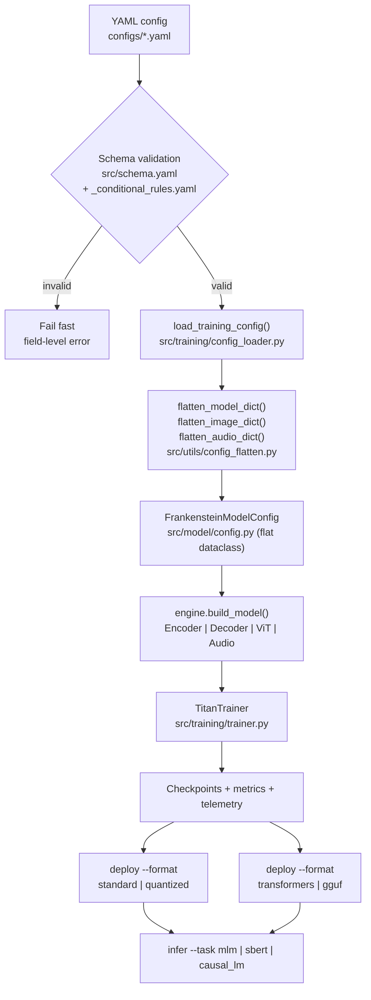
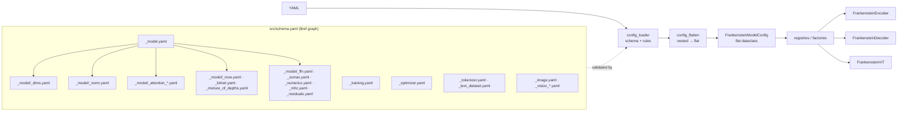
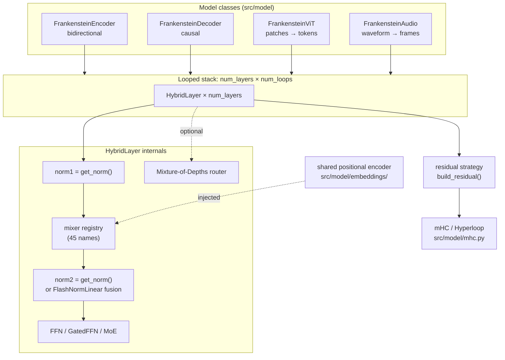
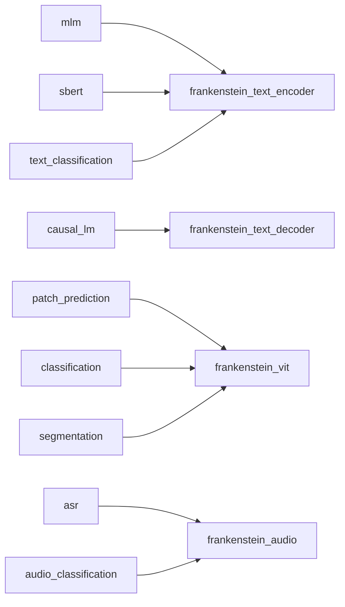
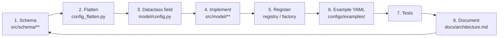

# Architecture & Extension Guide

> **Status:** canonical **implementation** specification — what the code does
> today and how to extend it. The LaTeX papers ([`docs/paper/`](paper/) and
> [`docs/paper-es/`](paper-es/)) are the source of truth for theory,
> formulations and citations; `src/schema/**` is the executable contract for
> configuration. The former `docs/specs/` directory was removed; do not
> recreate it. Agent-facing rules live in [`AGENTS.md`](../AGENTS.md),
> user-facing quickstart in [`README.md`](../README.md), and preset/optimizer
> parameters in [`configs/README.md`](../configs/README.md).

Frankenstein Transformer is a **schema-first**, configuration-driven toolkit for
experimenting with transformer sequence mixers, optimizers, normalization layers
and positional encodings without changing Python code. One strict JSON-Schema
validates a YAML file; the runtime flattens it into a single dataclass and
dispatches to factories and registries.

## 1. At a glance

| Dimension | Count | Defined in |
|---|---:|---|
| `model.dims.layer_pattern` values | **45** (44 concrete mixers + `mamba`) | `src/schema/_model/_dims.yaml` |
| Optimizer families | **25** | `src/schema/_optimizer.yaml` |
| Normalization types | **6** | `src/schema/_model/_norm.yaml` |
| Positional encodings | **12** (11 active + `none`) | `src/schema/_model/_positional_encoding.yaml` |
| FFN activations | **43** | `src/schema/_model/_ffn.yaml` |
| Model classes | **3** | `src/schema/_model_class.yaml` |
| Training tasks | **7** | `src/schema/_training.yaml` |
| Residual strategies | **4** | `src/schema/_model/_residuals.yaml` |
| Optimizer parameter groups | **4** | `src/model/optimizer/base.py` |
| CLI subcommands | **4** | `src/cli.py` |
| Deployment formats | **4** | `src/cli.py` (`deploy --format`) |

> The schema enums are the executable contract for code. README badges say
> "44 mixers / 11 positional encodings" because they exclude the placeholder
> `mamba` layer and the `none` encoding. The mathematical definitions stay in
> the paper; this document tracks what is actually wired up.

## 2. System overview

The YAML file is the single source of truth for model/training settings.
`--device` is the only training runtime override; the `infer` runtime flags and
`deploy --config` are documented in §8.3.

## 3. Repository map

| Path | Responsibility |
|---|---|
| `src/cli.py` | `frankenstein-transformer` entrypoint: `train`, `deploy`, `infer`, `web-server` |
| `src/schema.yaml` | JSON-Schema entrypoint; `$ref`s every module |
| `src/schema/**` | Schema modules (model, training, optimizer, datasets, vision, audio) |
| `src/training/config_loader.py` | Schema resolution + cross-field validation + `LoadedTrainingConfig` |
| `src/utils/config_flatten.py` | Nested YAML → flat `FrankensteinModelConfig` kwargs |
| `src/model/config.py` | `FrankensteinModelConfig` flat dataclass (single coupling point) |
| `src/model/hybrid_layer.py` | `HybridLayer`: mixer registry, norm wiring, FFN/MoE, MoD, BitNet, residual hand-off |
| `src/model/frankenstein_encoder.py` | Encoder backbone (bidirectional; owns shared PE, mHC, AttnRes) |
| `src/model/frankenstein_decoder.py` | Causal decoder (forces `mode=decoder`) |
| `src/model/frankenstein_vit.py` | Vision Transformer (forces `mode=encoder`) |
| `src/model/frankenstein_audio.py` | Audio model class: log-mel/spectrogram/raw frontend, conv subsampling, ASR and classification heads (forces `mode=encoder`) |
| `src/model/mhc.py`, `src/model/hyperloop.py` | Manifold-constrained hyper-connections and loop-level variants |
| `src/model/residuals/**` | Residual strategies + factory |
| `src/model/attention/**` | 45 mixers: `gated/`, `latent/`, `sparse/`, top-level modules |
| `src/model/norm/**` | 6 norms + factory |
| `src/model/embeddings/**` | 12 positional encodings + factorized embedding + factory |
| `src/model/cache/**` | KV-cache manager, typed slots, capability registry, quantization codecs, eviction policies |
| `src/model/activation_function/**` | 43 activations + `ALL_ACTIVATIONS` factory |
| `src/model/optimizer/**` | 25 optimizers + registry + parameter routing |
| `src/engine.py` | Framework-neutral `build_model()` used by CLI, DashAI plugin and exports |
| `src/training/main.py`, `trainer.py` | Task dispatch and training loop |
| `src/training/streaming_mlm_dataset.py` | Streaming MLM dataset |
| `src/training/vision_dataset.py` | Vision dataset |
| `src/training/audio_dataset.py` | Audio dataset (HF `datasets` decode + char tokenizer, `DummyAudioDataset`, SpecAugment) |
| `src/sbert/**` | SBERT training/inference |
| `src/deploy/**` | Quantization, deployment, HF export, GGUF export, inference |
| `src/streamlit_gui/app.py` | Schema-driven YAML builder |
| `configs/**` | Presets (`configs/*.yaml`) and smoke-tested examples (`configs/examples/*.yaml`) |
| `tests/**` | 46 files; see §12 for the gates that constrain extensions |

> `src/model/frankenstein_model.py` **does not exist**. It was split and a
> regression test (`tests/test_naming_conventions.py::test_shim_module_removed`)
> fails if it is recreated.

## 4. Configuration pipeline

### Top-level YAML keys

Only `training` is required. The rest are optional and cross-validated.

| Key | Schema module | Purpose |
|---|---|---|
| `base_model` | `_base_model.yaml` | HuggingFace model for continual pretraining; makes `model`/`model_class` optional |
| `tokenizer` | `_tokenizer.yaml` | `hf_repo` or `train_from_dataset` |
| `model_class` | `_model_class.yaml` | `frankenstein_text_encoder`, `frankenstein_text_decoder`, `frankenstein_vit` |
| `model` | `_model.yaml` | Architecture (required unless `base_model`) |
| `training` | `_training.yaml` | Task, runtime, optimizer/SBERT/heads |
| `image` | `_image.yaml` | ViT hyperparameters (required by vision tasks) |
| `vision_dataset` | `_vision_dataset.yaml` | Vision data loading |
| `text_dataset` | `_text_dataset.yaml` | HF text dataset loading |

### Flattening contract

`flatten_model_dict()` maps the nested `model:` tree to the flat dataclass used
everywhere else. It is deliberately explicit: unknown mixer sub-keys are
skipped, and `_ATTENTION_MIXER_RENAMES` maps each per-mixer leaf to its flat key.

| Nested path | Flat dataclass field |
|---|---|
| `model.dims.*` | same leaf name (`hidden_size`, `layer_pattern`, …) |
| `model.norm.type` | `norm_type` |
| `model.norm.partial_ratio` | `prms_partial_ratio` |
| `model.norm.flashnorm_partial_ratio` | `flashnorm_partial_ratio` |
| `model.embedding.factorized.enabled/dim` | `use_factorized_embedding`, `factorized_embedding_dim` |
| `model.embedding.conv.enabled/kernel` | `use_embedding_conv`, `embedding_conv_kernel` |
| `model.attention.<mixer>.<leaf>` | `_ATTENTION_MIXER_RENAMES` (e.g. `mla.latent_rank` → `mla_latent_rank`) |
| `model.moe.*` | `use_moe`, `num_experts`, `top_k_experts` |
| `model.bitnet.*` | `use_bitnet`, `bitnet_routers`, `use_bitnet_conv` |
| `model.mixture_of_depths.*` | `use_mixture_of_depths`, `mixture_of_depths_*` |
| `model.ssmax.*` | `use_ssmax`, `ssmax_s_init` |
| `model.numerics.*` | `fixed_softmax`, `fixed_cross_entropy` |
| `model.ffn.*` | `ffn_hidden_size`, `ffn_activation`, `ffn_activation_config` |
| `model.classification_head.*` | `classification_head`, `num_labels`, `encoder_pooling_mode` |
| `model.mhc.*` | `use_mhc`, `mhc_*` |
| `model.residuals.*` | `residual_type`, `full_attn_*`, `block_attn_*`, `attnres_*` |
| `image.*` (top-level) | `flatten_image_dict()` → `image_*`, `patch_size`, `pos_embedding_type`, … |

If the input is already flat (old checkpoint `config.json`), the flattener
returns it unchanged — checkpoints remain forward-compatible.

## 5. Model architecture

**Looped depth:** `L_logical = num_layers × num_loops`. Physical layers are
`num_layers`; weights are shared across loop iterations by position, so depth
grows without new parameters.

**BitNet wiring:** when `model.bitnet.enabled: true` (the default), primary and
gate `nn.Linear` layers are replaced by `BitLinear`; the FFN router and the
embedding conv follow `bitnet.routers` / `bitnet.conv`. `HybridLayer` is the only
place that chooses the projection class.

## 6. Model classes and tasks

| `model_class` | Mode | Allowed tasks | Notes |
|---|---|---|---|
| `frankenstein_text_encoder` | `encoder` or `decoder` | `mlm`, `sbert`, `text_classification` | Full mixer set, MoE, advanced norms |
| `frankenstein_text_decoder` | **forced `decoder`** | `causal_lm` | Causal masking; required by `training.task: causal_lm` |
| `frankenstein_vit` | **forced `encoder`** | `patch_prediction`, `classification`, `segmentation` | Requires `image:` block (+ `vision_dataset:` for data); patch embedding and vision heads |
| `frankenstein_audio` | **forced `encoder`** | `asr`, `audio_classification` | Requires `audio:` block (+ `audio_dataset:` for data); log-mel/spectrogram/raw frontend, conv subsampling, CTC/RNN-T/classification heads |

Cross-field rules enforced in `config_loader.py` and
`src/schema/_conditional_rules.yaml`:

- `hidden_size % num_heads == 0`.
- `num_kv_heads` divides `num_heads` (GQA/MSA/SparDA, CCGQA).
- `layer_pattern` length equals `num_layers`.
- `task: causal_lm` ⇒ `model_class: frankenstein_text_decoder`.
- Vision tasks ⇒ `model_class: frankenstein_vit`.
- Audio tasks (`asr`, `audio_classification`) ⇒ `model_class: frankenstein_audio`, with a required `audio:` block and `audio_dataset:` data (for `asr`, one with a `text_column`).
- `text_classification` ⇒ encoder.
- `base_model` requires `training` and (for MLM/causal LM) `tokenizer.name_or_path`.
- `mlm` requires `training.optimizer`; `sbert` requires `training.sbert`.
- `bitnet.routers: true` ⇒ `bitnet.enabled: true`; `bitnet.conv` only applies when BitNet and `embedding.conv.enabled` are both true.

## 7. Component reference

### 7.1 Core dimensions (`model.dims.*`)

| Field | Type | Default | Notes |
|---|---|---:|---|
| `vocab_size` | int ≥ 0 | 50000 | Must match the tokenizer |
| `hidden_size` | int ≥ 1 | 2048 | Divisible by `num_heads` |
| `num_layers` | int ≥ 1 | 12 | Physical layers |
| `num_loops` | int ≥ 1 | 2 | Logical-depth multiplier |
| `num_heads` | int ≥ 1 | 16 | Divides `hidden_size` |
| `num_kv_heads` | int ≥ 1 | 1 | GQA/MSA/SparDA/CCGQA |
| `dropout` | float [0,1] | 0.1 | Global |
| `layer_pattern` | enum array | — | Exactly `num_layers` entries |
| `mode` | `encoder` \| `decoder` | `encoder` | Forced by model class where noted |

### 7.2 Normalization (`model.norm.*`)

| `type` | Formula | Params | Notes |
|---|---|---|---|
| `layer_norm` | standard LayerNorm | γ, β | Baseline |
| `dynamic_tanh` | `tanh(α·x)` | α | DyT; normalization-free |
| `derf` | `erf(α·x + s)` | α, s | Normalization-free |
| `rms_norm` | `g·x / √(mean(x²)+ε)` | g | No mean subtraction |
| `prms_norm` | RMS over first `k = ⌈n·p⌉` dims | g | `p = norm.partial_ratio` (default 0.0625) |
| `flash_norm` | weightless RMS (`g ≡ 1`) | none | Optional partial RMS via `norm.flashnorm_partial_ratio`; fuses into the next projection when possible |

`get_norm()` in `src/model/norm/factory.py` dispatches; `prms_norm` reuses
`RMSNorm(partial_ratio=…)`, `flash_norm` uses `FlashNorm`.

### 7.3 Embeddings (`model.embedding.*`)

| Field | Default | Effect |
|---|---:|---|
| `factorized.enabled` | false | Embedding `V×H` → `V×R + R×H` |
| `factorized.dim` | 128 | Rank `R` |
| `conv.enabled` | **true** | Causal Conv1d over token embeddings |
| `conv.kernel` | 3 | Conv kernel size |

### 7.4 Sequence mixers (`model.dims.layer_pattern`)

45 enum values in 9 families. `config subkey` is the optional
`model.attention.<subkey>` object; "—" means no knobs.

| Mixer | Family | Config subkey | Train |
|---|---|---|---|
| `standard_attn` | Dense | — | yes |
| `sigmoid_attn` | Dense | — | yes |
| `gqa_attn` | GQA | `dims.num_kv_heads` | yes |
| `retnet` | Recurrent | `retnet.heads` | yes |
| `retnet_attn` | Recurrent | — | yes |
| `mamba` | Recurrent | — (linear placeholder) | yes |
| `ode` | Recurrent | `ode.solver`, `ode.steps` | yes |
| `titan_attn` | Recurrent | — | yes |
| `engram_attn` | Recurrent / memory | `engram.*` | yes |
| `sparse_transformer_attn` | Sparse | — | yes |
| `longformer_attn` | Sparse | — | yes |
| `swa_attn` | Sparse | `swa.*` | yes |
| `bigbird_attn` | Sparse | — | yes |
| `sparsek_attn` | Sparse | — | yes |
| `nsa_attn` | Sparse | — | yes |
| `msa_attn` | Sparse | `msa.*` | yes |
| `sparda_attn` | Sparse | `sparda.*` | yes |
| `sparge_attn` | Sparse | — | yes (dense train, sparse eval) |
| `fasa_attn` | Sparse | — | yes (dense train, sparse eval) |
| `gla_attn` | Gated | — | yes |
| `deltanet_attn` | Gated | — | yes |
| `gated_deltanet_attn` | Gated | — | yes |
| `gated_deltanet2_attn` | Gated | — | yes |
| `hgrn2_attn` | Gated | — | yes |
| `fox_attn` | Gated | — | yes |
| `gated_softmax_attn` | Gated | — | yes |
| `kda_attn` | Gated | — | yes |
| `falcon1_attn` | Fast-weight | `falcon.*` | yes |
| `falcon2_attn` | Fast-weight | `falcon.*` | yes |
| `falcon3_attn` | Fast-weight | `falcon.*` | yes |
| `falcon1a_attn` | Fast-weight | `falcon.*` | yes |
| `falcon2a_attn` | Fast-weight | `falcon.*` | yes |
| `falcon3a_attn` | Fast-weight | `falcon.*` | yes |
| `mla_attn` | Latent | `mla.latent_rank` | yes |
| `gqla_attn` | Latent | `gqla.*` | yes |
| `mlra_attn` | Latent | `mlra.*` | yes |
| `tucker_attn` | Latent | `tucker.*` | yes |
| `iha_attn` | Latent | `iha.*` | yes |
| `gta_attn` | Latent | `gta.*` | yes |
| `mtla_attn` | Latent | `mtla.*` | yes |
| `cca_attn` | Latent + conv | `cca.*` | yes |
| `ccgqa_attn` | Latent + GQA + conv | `ccgqa.*` | yes |
| `gma_attn` | Latent (Gaussian mixture) | `gma.*` | yes |
| `ssog_attn` | Geometric field | `ssog.*` | yes (encoder, grid input) |
| `conformer_attn` | Convolution-augmented | `conformer.*` | yes |

Inference-sparse mixers: `HybridLayer.TRAINING_FREE_LAYERS = {"fasa_attn", "sparge_attn"}`
run standard dense attention in `train()` mode (via `mixer.dense_forward`, sharing
the mixer's own `q/k/v/out` projections) and their sparse heuristic in `eval()`
mode. They can therefore appear in a training preset; the one-time `UserWarning`
marks the dense surrogate. See §2 (dispatch) and §9 (cache).

`swa_attn` implements SWA($w$, $s$) from arXiv:2608.28444: every query attends
to the first `swa.num_sinks` tokens plus the `swa.window_size -
swa.num_sinks` most recent tokens (causal in decoder mode, symmetric in
encoder mode). The mask is built vectorized; there are no extra parameters
beyond the standard attention projections, and the receptive field after `l`
layers is `l·(w−s)` plus the always-visible sink prefix.

Registry: the local `mixer_registry` dict in `src/model/hybrid_layer.py` maps
names to classes; `mamba` is handled as a linear projection special case.

### 7.5 Positional encodings (`model.positional_encoding`)

One shared module is built by the backbone and injected into every
`HybridLayer`. Per-mixer opt-out lives under
`model.positional_encoding_parameters.use_pe.<mixer>: false`.

| Encoding | Style | Key parameters |
|---|---|---|
| `rope` | Rotation | `rope.base` (10000), `rope.scaling` (1.0) |
| `hope` | Hyperbolic rotation | `hope.base`, `hope.damping` |
| `nope` | None | — |
| `alibi` | Score bias | `alibi.num_heads` |
| `bam` | Score bias | `bam.learn_mu`, `bam.theta_init`, `bam.eps`, `bam.mu_init` |
| `pape` | Q/K augmentation | `pape.num_parabolas`, `pape.num_positions`, `pape.rotation_invariant` |
| `pape_efficient` | Q/K augmentation | same as `pape` |
| `pape_ri` | Q/K augmentation | `pape.rotation_invariant` |
| `sinusoidal_absolute` | Additive | `sinusoidal.max_len`, `sinusoidal.base`, `sinusoidal.scale` |
| `sinusoidal_rotary` | Rotation | same as `sinusoidal_absolute` |
| `learned_absolute` | Additive | `learned.max_len`, `learned.init_std` |
| `none` | None | — |

SSMax (`model.ssmax.enabled`, `ssmax.s_init`) is a transversal logit rescale
`s·ln(n)` that composes with any encoding.

### 7.6 FFN and activations (`model.ffn.*`)

| Field | Default | Notes |
|---|---:|---|
| `hidden_size` | `null` | Defaults to `4 × hidden_size` in the model builder |
| `activation` | `silu` | 43 values (below) |
| `activation_config` | `{}` | Strict sub-object for learnable/parametric parameters |

Activation families (43): **standard** `silu`, `gelu`, `gelu_tanh`, `relu`,
`relu6`, `leaky_relu`, `prelu`, `sigmoid`, `tanh`, `softplus`, `mish`,
`hardswish`, `identity`, `softsign`, `arctan`, `elliott`; **rectified**
`abs_relu`, `nl_relu`, `brelu`, `vrelu`, `hexpo`, `ptanh`, `dis_relu`;
**exponential** `elu`, `selu`, `celu`, `pelu`, `mpelu`, `felu`, `eelu`,
`pdelu`, `preu`, `softexp`, `elish`, `hardelish`, `lisht`; **learnable**
`swish`, `swish_trainable`, `maxout`, `raf`; **gated (GLU)** `swiglu`, `geglu`,
`reglu`.

`get_activation()` raises on GLU names; `HybridLayer` builds a `GatedFFN`
instead. `activation_config` keys: `raf_degrees`, `raf_version`, `raf_approx_func`,
`raf_trainable`, `raf_input_scaling`, `prelu_init`, `elu_alpha`, `celu_alpha`,
`swish_beta`, `leaky_relu_slope`, `pelu_alpha`, `mpelu_alpha`, `mpelu_beta`,
`felu_alpha`, `eelu_alpha`, `eelu_beta`, `pdelu_alpha`, `preu_alpha`,
`preu_beta`, `softexp_alpha`, `maxout_pieces`.

### 7.7 Routing and quantization blocks

| Block | Keys (defaults) | Behaviour |
|---|---|---|
| MoE | `moe.enabled` (**true**), `moe.num_experts` (8), `moe.top_k` (2) | Replaces dense FFN with top-k expert routing |
| Mixture-of-Depths | `mixture_of_depths.enabled` (false), `capacity_ratio` (0.5), `router_aux_loss_weight` (0.0) | Top-`capacity_ratio` tokens are updated; skipped tokens bypass the block. **Mutually exclusive with mHC** |
| SSMax | `ssmax.enabled` (false), `ssmax.s_init` (1.0) | Per-head learnable logit rescale `s·ln(n)` |
| Fixed numerics | `numerics.fixed_softmax` (false), `numerics.fixed_cross_entropy` (false) | Cancellation-free softmax/log-softmax and zero-sum-gradient hard-target CE (arXiv:2610.31642) |
| BitNet | `bitnet.enabled` (**true**), `bitnet.routers` (false), `bitnet.conv` (false) | Ternary `BitLinear` projections; routers/conv opt-in |

**Fixed numerics (arXiv:2610.31642).** `numerics.fixed_softmax` swaps every
explicit softmax/log-softmax (all attention mixers, MoE/MoD routers, AttnRes
depth-wise softmax, KV-cache recompute paths and decoder sampling) for
`src/model/numerics.py::fixed_softmax`, which excludes the argmax logit from
the log-sum-exp and combines the margin with `softplus`. Forward values are
mathematically identical; the backward pass keeps the argmax softmax Jacobian
at its true magnitude `~e^{-m}` past the dtype's precision cliff (≈5.5 bf16 /
16.6 fp32 / 36.7 fp64), where the standard implementation rounds it to zero
(Softmax Collapse). `numerics.fixed_cross_entropy` swaps the hard-target task
losses (mlm, causal_lm, classification, segmentation, text_classification,
patch_prediction) for `fixed_cross_entropy`, whose target gradient equals
minus the sum of the non-target gradients by construction, so the gradient
sums to zero at any margin. The helper takes a `class_dim` argument (`-1` for
token/patch heads `(..., vocab_size)`, `1` for dense per-pixel heads
`(B, C, H, W)`); the trainer forwards it so segmentation CE matches
`F.cross_entropy`'s class axis. Soft-target/distillation CE (Softmax Cancellation)
is not used by this codebase and is therefore out of scope. The internal SSOG
LSE kernels keep their own formulation. `HybridLayer` attaches the resolved
flag as `mixer.use_fixed_softmax`; the residual factory does the same for
AttnRes modules, mirroring the SSMax `getattr` pattern.

### 7.8 Residuals, mHC and Hyperloop (`model.residuals.*`, `model.mhc.*`)

| `residuals.type` | Module | Semantics |
|---|---|---|
| `standard` | `StandardResidual` | `x + f(x)` |
| `none` | `NoResidual` | No residual sum |
| `full_attn` | `FullAttentionResidual` | AttnRes over all previous layers (`init_query_zero`, `use_rmsnorm_keys`) |
| `block_attn` | `BlockAttentionResidual` | AttnRes over `num_blocks` groups (`block_attn.*`) |

mHC (`model.mhc.enabled`, expansion rate 4, Sinkhorn iterations 20) maintains
`n` residual streams instead of one. Hyperloop (`mhc.hyperloop`) moves the
hyper-connections to loop level, which makes MoD compatible again. Residual
options: `residuals.mhc_stream_mode` (`independent`/`joint`) and
`residuals.gradient_checkpoint`.

### 7.9 Classification head (`model.classification_head.*`)

| Field | Default | Notes |
|---|---:|---|
| `enabled` | false | Adds a sequence-level head; used by `text_classification` |
| `num_labels` | `null` | Required when enabled |
| `pooling_mode` | `cls` | `cls` or `gap` |

### 7.10 Engram knobs (`model.attention.engram.*`)

| Field | Default |
|---|---:|
| `max_ngram_size` | 3 |
| `n_heads_per_ngram` | 4 |
| `embed_dim_per_head` | 32 |
| `kernel_size` | 4 |
| `seed` | 42 |

Hidden width = `(max_ngram_size − 1) × n_heads_per_ngram × embed_dim_per_head`.

### 7.11 Vision Transformer (`image.*`, `vision_dataset.*`)

`frankenstein_vit` splits the image into patches, embeds them, adds positional
information and runs the same `HybridLayer` stack. It forces `mode: encoder`
and requires the top-level `image:` block; supervised tasks also require
`vision_dataset:`.

| `image.*` field | Default | Notes |
|---|---:|---|
| `image_size.{height,width}` | — | Required |
| `patch_size` | 16 | Patch edge |
| `in_channels` | 3 | RGB |
| `to_grayscale` | false | Collapse channels |
| `pos_embedding_type` | `learned_1d` | Unified with the PE enum; `learned_1d` → `learned_absolute` |
| `cls_token` | true | Prepend a CLS token |
| `pooling_mode` | `cls` | `cls` or `gap` |
| `mask_ratio` | 0.5 | Masked-patch pre-training |
| `mask_token_strategy` | `bert` | `bert`, `mask_only`, `random_only` |
| `prediction_target` | `mean_color_3bit` | `mean_color_3bit`, `downsampled_3bit`, `full_patch_l2` |
| `seg_head_type` | `pixel` | `pixel` or `eomt` |
| `num_classes` | `null` | Classification head width |
| `num_seg_classes` | 21 | Segmentation classes |
| `seg_num_queries` | 100 | EoMT queries |
| `seg_l2_blocks` | 3 | EoMT L2 blocks |
| `seg_mask_annealing` | true | EoMT mask annealing |

| `vision_dataset.*` field | Default | Notes |
|---|---:|---|
| `dataset_name` | — | HuggingFace dataset identifier |
| `dataset_dir` | `null` | Local fallback |
| `image_column` | `image` | Column name |
| `label_column` | `label` | Classification |
| `segmentation_column` | `segmentation_map` | Segmentation |
| `rescale.{height,width}` | — | Required resize target |
| `normalize.{mean,std}` | — | Optional normalization |
| `augmentations.{random_crop,horizontal_flip,color_jitter,mixup_alpha}` | — | Training augmentations |

Tasks: `patch_prediction` (autosupervised pre-training), `classification`
(image labels), `segmentation` (`pixel` or EoMT).

### 7.12 SBERT (`training.sbert.*`)

SBERT reuses the encoder backbone with a pooled sentence-embedding objective.
It is selected by `training.task: sbert` and configured under `training.sbert`.

| Field | Default | Notes |
|---|---:|---|
| `dataset_name` | — | HuggingFace dataset |
| `dataset_type` | — | `paired_similarity`, `triplets`, `qa` |
| `columns.sentence1/sentence2/similarity` | — | Paired-similarity columns |
| `columns.query/positive/negatives` | — | Triplet columns |
| `columns.question/answer` | — | QA columns |
| `query_prefix`, `document_prefix` | `null` | Instruction prefixes |
| `output_dir` | — | Checkpoint destination |
| `pooling_mode` | — | `mean`, `cls`, `max` |
| `optimizer.optimizer_class` | — | Same 25-family enum |
| `batch_size`, `num_epochs`, `learning_rate`, `warmup_steps` | — | Training schedule |
| `evaluation_steps`, `checkpoint_save_steps`, `resume_from_checkpoint` | — | Checkpointing |
| `use_amp`, `trust_remote_code`, `resample_balanced`, `standardize_scores` | — | Runtime options |

Inference: `infer --task sbert --mode similarity|search|cluster ...`.

### 7.13 KV cache and incremental decoding (`inference.*`)

Opt-in KV-cache infrastructure for autoregressive decoding. The package
lives in `src/model/cache/` and is enabled by `inference.kv_cache.enabled`
(default `false` — the legacy full-recompute path stays bit-identical).

**Architecture (D1).** One central `FrankensteinCache` manager
(HF `past_key_values`-style) is threaded
`decoder → encoder → HybridLayer → mixer` as an optional keyword argument.
Slot identity is the global `logical_layer_idx` (D6 — correct under
`num_loops`/Hyperloop where the same physical layer executes with distinct
logical roles). Per-layer storage is typed:

| Slot | Kind | Stores | Used by |
|---|---|---|---|
| `KVSlot` | `kv` | post-RoPE K/V `(B,H_kv,T,D)`, absolute `positions`, per-token `extras` | quadratic softmax mixers |
| `LatentKVSlot` | `latent_kv` | named latent streams (`c_kv`, `k_rope`, grouped keys + latent values) | latent family |
| `StateSlot` | `state` | fixed recurrent matrix (+ gate accumulators), updated in place | recurrent/linear family |
| `RingSlot` | `ring` | capacity-bounded K/V with pinned sinks | sliding-window family |
| `ConvTailSlot` | `conv_tail` | last `kernel-1` pre-conv rows | falcon/CCA (future) |
| `TokenTailSlot` | `token_tail` | last `n` token ids | engram |

**Capability registry (D5).** `src/model/cache/capabilities.py` holds one
`CacheSpec` per `layer_pattern` enum value (45). A layer caches only when
the spec says `supported` **and** the mixer is in `IMPLEMENTED_MIXERS`
(incremental branch implemented + parity-tested). Everything else receives
`cache=None` and runs the legacy path — **inference never fails because of
the cache**; `config_loader` warns about the fallback mixers.

Implemented cached branches (parity-tested in
`tests/test_kv_cache_mixers.py`): `standard_attn`, `gqa_attn`,
`sigmoid_attn`, `gated_softmax_attn`, `titan_attn`, `fox_attn`,
`mla_attn`, `gqla_attn`, `mlra_attn`, `tucker_attn`, `iha_attn`,
`gta_attn`, `swa_attn`, `longformer_attn`, `bigbird_attn`,
`sparse_transformer_attn`, `fasa_attn`, `retnet`, `retnet_attn`,
`gla_attn`, `deltanet_attn`, `gated_deltanet_attn`,
`gated_deltanet2_attn`, `hgrn2_attn`, `kda_attn`, `gma_attn`.
Documented fallbacks: `mamba` (stateless), `ssog_attn` (bidirectional
vision grid, no causal formulation), `ode` (solver re-derives all
intermediate states each step), `falcon*` (chunk-parallel rehearsal FIFO),
`cca_attn`/`ccgqa_attn` (conv tails), `engram_attn` (token tail),
`nsa_attn`/`msa_attn`/`sparda_attn`/`sparge_attn` (chunk-level block
statistics are not row-local), `mtla_attn` (dynamic merge schedule),
`sparsek_attn` (policy in F4), plus every PaPE-configured layer (D10).

**Positional encodings (§8 of the plan).** RoPE/HoPE/sinusoidal-rotary
accept `position_offset` (blocker B1); ALiBi/BAM accept
`bias(q_len, kv_len, q_offset, kv_positions)` (B2); SSMax rescales by
`ln(kv_len)` (B6). Absolute PEs receive `position_offset` in `add()`.
Keys are stored **post-RoPE** (D7); the slot versions `rope_scaling`.

**Quantization (F3, D3).** Write-time codecs in `src/model/cache/quant/`:
`none`, `int8` (KIVI asymmetric axes: K per-channel, V per-token),
`int4_kivi` (group-wise int4 + protected full-precision window + pinned
sinks). Recurrent states are never quantized (D12). Future codecs are
interface-ready but not implemented (`int2_kivi`, `palu_lowrank`,
`commvq`, `qjl_sketch`, `block_gtq`).

**Compression (F4).** Read-time policies in
`src/model/cache/compress/`: `none`, `window_sinks` (StreamingLLM:
pinned sinks + sliding window). Future: `h2o`, `snapkv_prefill`,
`pyramid`, `sparsek`-as-policy.

**Mechanism interactions.** MoD runs forced-dense at prefill when caching
(D8; ragged caches out of scope); decode degenerates to dense. mHC
n-streams and Hyperloop loop streams are per-token (no cross-step carry).
AttnRes residuals disable caching per forward with a warning until the
incremental buffer mode lands.

**`generate()` (D12).** With `use_cache=False` the legacy O(S²) loop runs
bit-identically. With `use_cache=True`: one prefill forward builds the
cache, then each step feeds only the last token. `greedy`, `top_k`,
`top_p` are supported; `truncate()` provides cheap rollback.

**CLI.** `infer --task causal_lm` with `--prompt`,
`--max-new-tokens/--temperature/--top-k/--top-p/--greedy`,
`--kv-cache/--no-kv-cache`, `--kv-quant`, `--kv-group-size`,
`--kv-protected-window`, `--kv-compress`, `--kv-num-sinks`,
`--kv-window`, `--config` (see §8.3).

**Deploy.** `ModelDeployer` serialises the resolved `InferenceConfig`
into `config.json` (`"inference": {...}`); the HF export's
`FrankensteinForCausalLM` now accepts `past_key_values`/`use_cache`/
`cache_position` (blocker B7).

### 7.14 Audio (`audio.*`, `audio_dataset.*`)

`frankenstein_audio` turns waveforms into frames and runs the same
`HybridLayer` stack as the text encoder. It forces `mode: encoder`
(bidirectional, symmetric convolution padding) and is required by
`training.task: asr | audio_classification`; see Annexes 17–18 of
[`docs/paper/`](paper/) for the theory. ASR head knobs live under `audio.*`
(the `asr_*` prefix); an optional `training.asr.loss` block overrides
`audio.asr_loss` for presets that only want to switch the loss (the value
must still match the head built from the model block).

| `audio.*` field | Default | Notes |
|---|---:|---|
| `feature` | `logmel` | `logmel`, `spectrogram`, or `raw` (multichannel 1-D signals such as EEG/EMG) |
| `sample_rate` | 16000 | Turns `window_ms`/`stride_ms` into samples |
| `n_mels` | 80 | Mel bins (`logmel` only) |
| `window_ms` / `stride_ms` | 25 / 10 | Hann window and hop |
| `n_fft` | 400 | STFT size; must cover the window (`25 ms × 16 kHz`) |
| `in_channels` | 1 | Channel count of the input map (`raw` sets it to the sensor count) |
| `conv_channels` | 32 | Channels of the two stride-2 `Conv2d(3×3)` subsampling stages (fixed 4× reduction) |
| `pooling_mode` | `gap` | `gap` or `cls`; used by `audio_classification` |
| `num_classes` | 2 | Classification head width |
| `asr_loss` | `ctc` | `ctc` or `transducer` (RNN-T) |
| `asr_decoder_dim` | 320 | RNN-T prediction-network width (paper: 320/640/640 for S/M/L) |
| `asr_decoder_layers` | 1 | LSTM predictor depth (kept shallow for the O(T·U) lattice) |
| `asr_decoder_dropout` | 0.1 | Predictor dropout |
| `spec_augment.enabled` | `false` | Frequency/time masking (no time warping); applied in the frontend, training only |
| `spec_augment.freq_mask_width` | 27 | Paper value `F` |
| `spec_augment.time_masks` | 10 | Paper value `m_T` |
| `spec_augment.time_mask_ratio` | 0.05 | Paper value `p_S` |

| `audio_dataset.*` field | Default | Notes |
|---|---|---|
| `dataset_name` / `dataset_dir` | `""` | HuggingFace dataset id, or a local audio directory; both empty ⇒ `DummyAudioDataset` |
| `split` | `train` | Dataset split |
| `audio_column` | `audio` | Audio column; decoded to arrays |
| `text_column` | `text` | Transcript column (required by `asr`) |
| `label_column` | `""` | Label column (`audio_classification`; required there) |
| `max_duration_sec` | 30.0 | Clips longer than this are skipped/truncated |
| `resample` | `true` | Resample decoded audio to `audio.sample_rate` |

`torchaudio` is an optional `audio` extra: the frontend uses
`torchaudio.transforms` when importable and otherwise a pure-PyTorch
`torch.stft` + mel filterbank fallback, so CPU CI stays torchaudio-free.
The HuggingFace and GGUF exports reject audio artifacts explicitly;
`standard`/`quantized` work.

## 8. Training runtime

### 8.1 Optimizers (25)

`training.optimizer.optimizer_class` selects a family; SBERT uses
`training.sbert.optimizer.optimizer_class` with the same enum.

| Family | Class | Character |
|---|---|---|
| SGD | `sgd_momentum` | Baseline, momentum/nesterov |
| AdamW | `adamw` | Default, decoupled weight decay |
| Memory-efficient | `adafactor`, `lion`, `galore_adamw`, `apollo`, `apollo_mini`, `q_apollo` | Factored/low-rank/quantized state |
| Auto-LR | `prodigy`, `schedulefree_adamw` | Remove LR tuning/scheduling |
| Adaptive | `radam`, `adan`, `adopt`, `ademamix`, `mars_adamw`, `cautious_adamw`, `lamb` | Rectification, Nesterov, dual EMA, variance reduction, masking, layer-wise scaling |
| Second-order | `sophia`, `shampoo`, `soap` | Diagonal Hessian / Kronecker / eigenbasis |
| Orthogonalized | `muon`, `turbo_muon`, `af_muon`, `ada_muon` | Momentum orthogonalization; `ada_muon` adds an element-wise second moment on the orthogonalized direction with RMS-aligned Adam-scale updates; `af_muon` adds a capped-row LMO for the vocabulary table and RMS updates for vectors (AdamW-free, a single first-moment buffer) |
| Tunable | `anon` | `gamma` adaptivity |

**Parameter groups:** `embeddings`, `pos`, `attention`, `ffn`, `norms`,
`head`, `mhc`, `router`, `residual`, `other`. The taxonomy is the same one
used by the parameter estimator and the `grad_norm_<block>` logs
(`src/utils/param_categories.py`; `norm` maps to the historical plural
`norms`). Mixer parameters — including nested QK-norms and ODE/RetNet/Mamba
state — route to `attention`; MoE experts route to `ffn`, routers to
`router`, and task heads to `head`. Grouping is shared by the trainer and
`FrankensteinViT.configure_optimizers` through
`src.model.optimizer.base.categorize_param_groups`.

**Prefix contract:** `<optimizer_class>-<group>_<param>` for per-group keys
(`adamw-lr_embeddings`, `muon-lr_attention`, …) and
`<optimizer_class>-<param>` for global optimizer keys (`muon-ns_steps`,
`sgd_momentum-momentum`, `q_apollo-quant_bits`). The schema's
`x_parameter_reference.by_optimizer` lists every prefix and allowed suffix;
`factory.OPTIMIZER_ALLOWED_KEYS` rejects anything else.

### 8.2 Runtime safety

`training.*` exposes AMP, gradient accumulation/clipping, scheduler selection
(`cosine`, `constant`, `linear_warmup_then_constant`), rolling checkpoints,
NaN retries, CSV/NVML telemetry, the GPU thermal guard (`gpu_temp_*`), and
optional GaLore settings. The guard pauses at `gpu_temp_pause_threshold_c`
(default 90 °C) and resumes at `gpu_temp_resume_threshold_c` (80 °C).

**Per-block gradient norms.** With `enable_block_grad_norms: true` (default),
each logged step records the L2 gradient norm of every canonical parameter
block — `embeddings`, `pos`, `attention`, `ffn`, `norm`, `head`, `mhc`,
`router`, `residual`, `other` — as `grad_norm_<block>` CSV columns and in the
`metrics_callback` payload. The taxonomy is defined once in
`src/utils/param_categories.py` and shared with
`full_tests/param_count_check.py`, so it matches the website parameter
estimator breakdown. Mixer-internal norms (QK-norm, GroupNorm) count as
`attention`; MoE experts count as `ffn`, exactly as in the estimator. The
legacy CSV schema (which had `experts`/`ode`/`retnet`/`mamba`/`norms` columns)
rotates automatically under `csv_rotate_on_schema_change: true`.

**Weights & Biases.** `training.wandb_project` (unset by default) enables W&B
step logging; `training.wandb_mode` is `online`/`offline`/`disabled`. When
`enable_block_grad_norms` is also true, each block is logged as
`grad_norm/<block>` alongside loss, LR, `grad_norm`, clip ratio, step time,
tokens/s and GPU telemetry. W&B lives in the optional `wandb` extra
(`pip install -e ".[wandb]"`); without it, a configured project emits a
one-time warning and training continues.

### 8.3 CLI surface

The CLI exposes exactly four subcommands. `--device` is the only runtime
override for training; the `infer` subcommand additionally accepts
generation/KV-cache flags (CLI > YAML `inference:` > schema default).

| Subcommand | Key flags | Behaviour |
|---|---|---|
| `train` | `--config`, `--config-name`, `--device`, `--list-configs` | Validates and trains (MLM, SBERT, causal LM, vision, text classification, ASR, audio classification) |
| `deploy` | `--checkpoint`, `--output`, `--format`, `--yaml`, `--config`, `--validate`, `--check`, `--device` | `standard`/`quantized` artifacts; `transformers`/`gguf` exports. `--config` is a JSON model config for `standard`/`quantized` only. |
| `infer` | `--model`, `--task {mlm,sbert,causal_lm}`, `--mode`, `--config`, `--device`, `--batch-size`, `--fp16`, `--benchmark`, `--benchmark-generation`, `--text`, `--input`, `--output`, `--sentence1`, `--sentence2`, `--query`, `--corpus-file`, `--sentences-file`, `--input-file`, `--output-file`, `--top-k`, `--n-clusters`, `--prompt`, `--max-new-tokens`, `--temperature`, `--top-p`, `--greedy`, `--kv-cache/--no-kv-cache`, `--kv-quant`, `--kv-group-size`, `--kv-protected-window`, `--kv-compress`, `--kv-num-sinks`, `--kv-window` | MLM, SBERT or autoregressive generation (with optional KV cache) |
| `web-server` | `--server-port`, `--server-address`, `--server-headless`, `--development-mode` | Streamlit schema-driven YAML builder |

`--format transformers|gguf` requires `--yaml`; `--check` is only valid with
`gguf`; `deploy --config` is rejected for export formats. `infer --task
causal_lm` requires a decoder artifact (`config.mode == "decoder"`); every
generation/cache flag defaults to `None` (no override).

## 9. Data paths

| Path | Builder | Task |
|---|---|---|
| Tokenizer `hf_repo` | `src/tokenizer/**` | all text tasks |
| Tokenizer `train_from_dataset` | `src/tokenizer/train_tokenizer.py` + `text_dataset` | MLM/causal LM with a custom vocab |
| Streaming MLM | `src/training/streaming_mlm_dataset.py` | `mlm` |
| HF text dataset | `src/training/text_dataset_builder.py` | `mlm`, `text_classification` |
| SBERT datasets | `training.sbert` (`paired_similarity`, `triplets`, `qa`) | `sbert` |
| Vision dataset | `src/training/vision_dataset.py` | `patch_prediction`, `classification`, `segmentation` |
| Audio dataset | `src/training/audio_dataset.py` (HF `datasets` decode or `DummyAudioDataset`) | `asr`, `audio_classification` |

## 10. Deployment and export

`frankenstein-transformer deploy` accepts four formats:

| Format | Output | Requires `--yaml` |
|---|---|---|
| `standard` | FP32 checkpoint | no |
| `quantized` | BitNet ternary / compact artifact | no |
| `transformers` | HuggingFace `config.json` + `modeling_*.py` | yes |
| `gguf` | GGUF file (BitNet), `--check` supported | yes |

`infer` runs MLM/SBERT inference against a deployed artifact. The HuggingFace
export is compatibility-checked against the YAML before writing anything; SBERT
and audio artifacts are rejected explicitly (no upstream mapping).

## 11. Extending the software

The order matters: schema first (the contract), implementation second, example
last. Every step below ends with the gates in §12.

### 11.1 Add an attention mixer

1. Implement the module in `src/model/attention/<family>/<name>.py` (families:
   `gated/`, `latent/`, `sparse/`, or top level) with the same constructor
   signature as peers: `(config, pos_encoder=...)`.
2. Export it from `src/model/attention/<family>/__init__.py` and
   `src/model/attention/__init__.py` (`__all__`).
3. Register it in the `mixer_registry` dict in `src/model/hybrid_layer.py`.
4. Add the name to `src/schema/_model/_dims.yaml`:
   `layer_pattern.items.enum` **and** both `description` / `description_es`
   tables (the consistency test scans them).
5. If it has knobs: add `src/schema/_model/_attention_<mixer>.yaml`, `$ref` it
   under `model.attention` in `_model.yaml`, add the leaf renames to
   `_ATTENTION_MIXER_RENAMES` in `src/utils/config_flatten.py`, and add flat
   fields to `FrankensteinModelConfig` (`src/model/config.py`).
6. Add `configs/examples/<family>_<mixer>_adamw.yaml`.
7. If the mixer has an incremental branch, add a `CacheSpec` to
   `src/model/cache/capabilities.py` and list it in `IMPLEMENTED_MIXERS`;
   otherwise register `supported=False` (as `conformer_attn` does) and rely
   on the legacy full-recompute path.
8. Test: `tests/test_schema_attention_layers.py`,
   `tests/test_attention_refactor.py`, plus the family test
   (`test_gated_attention.py`, `test_sparse_attention.py`,
   `test_latent_attention.py`, `test_attention_modules.py`).

### 11.2 Add an optimizer

1. Implement `src/model/optimizer/<name>.py` as a `torch.optim.Optimizer`
   subclass.
2. Export from `src/model/optimizer/__init__.py`.
3. Register in `factory.py`: import, `OPTIMIZER_REGISTRY[name]`, and add the
   allowed keys to `OPTIMIZER_ALLOWED_KEYS` (shared per-group keys plus any
   global suffixes).
4. Extend `src/schema/_optimizer.yaml`: `optimizer_class.enum` and a
   `parameters.x_parameter_reference.by_optimizer.<name>` entry with `prefix`.
5. Add the matching `^<name>-:` `if/then` block to
   `src/schema/_training.yaml` (the parity test requires exactly one).
6. Add `configs/examples/*_<name>.yaml`.
7. Test: `tests/test_optimizer_factory.py`, `tests/test_optimizer_base.py`,
   `tests/test_schema_consistency.py`.
8. Document the suffixes in `configs/README.md`.

### 11.3 Add a normalization layer

1. Implement `src/model/norm/<name>.py`.
2. Import and dispatch in `src/model/norm/factory.py`.
3. Add the enum value (and any parameters with defaults) to
   `src/schema/_model/_norm.yaml`.
4. Add flat fields to `FrankensteinModelConfig`; if the schema key is nested,
   add the rename in `config_flatten.py`.
5. Add a schema default ↔ dataclass parity entry in
   `tests/test_schema_consistency.py::_DEFAULT_PAIRS` when a default is declared.
6. Add `configs/examples/norm_<name>.yaml` and extend
   `tests/test_common_modules.py`.
7. If the norm can be fused into a projection (FlashNorm pattern), wire it in
   `HybridLayer` and cover the fused path in `tests/test_hybrid_layer.py`.

### 11.4 Add a positional encoding

1. Implement `src/model/embeddings/<name>.py`.
2. Register it in `src/model/embeddings/factory.py`.
3. Add the enum value and parameter sub-object to
   `src/schema/_model/_positional_encoding.yaml`; add the mixer opt-out flag to
   `positional_encoding_parameters.use_pe` if needed.
4. Extend `_flatten_pe_parameters()` in `config_flatten.py` and the flat fields
   in `FrankensteinModelConfig`.
5. Add `configs/examples/pe_<name>.yaml` and tests in
   `tests/test_positional_encodings.py`.
6. For ViT, keep `image.pos_embedding_type` in sync with the unified enum.

### 11.5 Add an activation

1. Implement in `src/model/activation_function/<family>.py` (`common.py`,
   `rectified.py`, `exponential.py`, `learnable.py`, `glu.py`).
2. Add it to `ALL_ACTIVATIONS` and the dispatch in `factory.py`. GLU variants
   must raise in `get_activation()` and be handled by `GatedFFN` in
   `HybridLayer`.
3. Add it to `_ffn.yaml` `activation.enum`; add any knobs to
   `activation_config` and validate them in
   `FrankensteinModelConfig._validate_ffn_activation_config`.
4. Add `configs/examples/activation_<name>.yaml` and
   `tests/test_activation_functions.py` cases.
5. Update the paper annexes only when the activation is part of a release.

### 11.6 Add a residual strategy

1. Implement `src/model/residuals/<name>.py` subclassing `ResidualBase`.
2. Add it to `RESIDUAL_TYPES` and `build_residual()` in
   `src/model/residuals/factory.py`; export from `__init__.py`.
3. Add the enum value and parameters to `_residuals.yaml`, then the flat fields
   and flatten renames.
4. Add an example and extend `tests/test_residuals.py`.

### 11.7 Add a model class

1. Implement `src/model/frankenstein_<class>.py` and export it from
   `src/model/__init__.py`.
2. Add the enum value and description to `_model_class.yaml`.
3. Extend `valid_model_classes` and the task rules in
   `src/training/config_loader.py`.
4. Dispatch it in `src/engine.py` (`build_model`), `src/training/main.py`,
   `src/deploy/{deploy,inference,transformers_export}.py`, and the CLI model
   choices in `src/cli.py`.
5. Add the preset + `configs/examples/` entry and tests
   (`tests/test_model_variants.py`; `test_frankenstein_vit.py` and
   `test_frankenstein_audio.py` are the current examples).
6. Add the modality block (`image:` / `audio:`) to `src/schema.yaml`, the
   flattener entry (`flatten_image_dict` / `flatten_audio_dict`) and the
   `LoadedTrainingConfig` side channel.
7. The Streamlit builder reads the schema, so no GUI change is needed beyond
   field metadata; a new top-level block also needs its `render_object` titles.

### 11.8 Add a config field

1. Add the field to the correct `src/schema/**` module (keep
   `additionalProperties: false`).
2. If nested, map it in `config_flatten.py`; otherwise it passes through.
3. Add the flat dataclass field in `src/model/config.py` with the same default.
4. If the schema declares a default, add the pair to `_DEFAULT_PAIRS`.
5. Add or update an example YAML; the smoke test picks it up automatically.
6. Document it in §7 and in `configs/README.md` when it is user-facing.

### 11.9 Add a dataset or task

1. Add `src/schema/_<name>.yaml` and `$ref` it from `src/schema.yaml`.
2. Add the builder under `src/training/` and wire it in `src/engine.py`.
3. Extend `config_loader.py` task validation and
   `src/training/trainer.py` loss methods.
4. Add a preset/example and the matching `tests/test_*dataset*.py`.

## 12. Validation gates

Every extension must keep these green. Run them on CPU (see `AGENTS.md`).

| Gate | Locks |
|---|---|
| `tests/test_schema_consistency.py::test_all_presets_validate` | Every `configs/*.yaml` and `configs/examples/*.yaml` validates |
| `::test_layer_pattern_enum_matches_documentation` | `layer_pattern` enum ↔ bilingual table |
| `::test_optimizer_prefixes_match_conditional_rules` | `by_optimizer` prefixes ↔ `_training.yaml` `if/then` blocks |
| `::test_schema_defaults_match_dataclass` | Declared schema defaults ↔ `FrankensteinModelConfig` |
| `::test_legacy_flat_feature_keys_are_gone` | No flat feature keys in `_model.yaml` |
| `tests/test_yaml_examples.py` | Loads every config in both directories (auto-globbed) |
| `tests/test_schema_attention_layers.py` | Mixer enum + `model.attention.*` sub-keys |
| `tests/test_naming_conventions.py` | No `frankenstein_model.py` shim, no legacy names |
| `tests/test_optimizer_factory.py` / `test_optimizer_base.py` | Registry, allowed keys, step |
| `tests/test_common_modules.py` | Norm implementations |
| `tests/test_positional_encodings.py` | PE math and wiring |
| `tests/test_activation_functions.py` | Every activation value |
| `tests/test_residuals.py` | Residual strategies |
| `tests/test_frankenstein_vit.py`, `test_vision_*` | Vision path |
| `tests/test_conformer_attention.py` | Conformer mixer: shapes, causality, formula parity, PE on/off, Macaron on/off, BitNet, conv norms |
| `tests/test_frankenstein_audio.py` | Audio model class: per-task forwards, forced mode, pooling, `logmel`/`spectrogram`/`raw` frontends |
| `tests/test_audio_dataset.py`, `test_asr_losses.py`, `test_audio_loss.py`, `test_audio_training.py`, `test_audio_param_categories.py` | Audio datasets, SpecAugment, CTC/RNN-T losses, greedy decode + CER, trainer/engine smoke, estimator categories |

## 13. Decisions

| # | Decision | Rationale |
|---|---|---|
| D1 | The JSON Schema is the contract; `additionalProperties: false` everywhere | Unknown keys fail fast instead of silently doing nothing |
| D2 | Keep one flat `FrankensteinModelConfig` plus an explicit flattener | The runtime stays simple and old checkpoints stay loadable |
| D3 | Split the old `frankenstein_model.py` into `config.py`, `hybrid_layer.py`, encoder/decoder/ViT | Smaller coupling surface; enforced by a regression test |
| D4 | `model.bitnet.enabled` defaults to **true** | BitNet is the project's deployment story; disable explicitly for FP32 |
| D5 | `fasa_attn` and `sparge_attn` train as dense attention and infer sparsely | Their selection/pruning rules are inference-time by design; the dense surrogate shares the projections so trained weights are exactly the ones the sparse path reads |
| D6 | mHC and Mixture-of-Depths are mutually exclusive | MoD routes a single C-dimensional stream; mHC keeps `n` streams |
| D7 | Develop and test on CPU | Reproducible, CI-parity, no GPU required; CUDA is only for real runs |
| D8 | Every preset/example is schema-smoke-tested | A broken YAML cannot reach `main` |
| D9 | Optimizer prefixes are enumerated and cross-checked | Prevents typo'd hyperparameters from being ignored |
| D10 | Model classes force their mode (`decoder` for the text decoder, `encoder` for ViT and audio) | Causal, vision and audio paths cannot be configured inconsistently |
| D11 | The paper is the source of truth for theory; `docs/architecture.md` is the single canonical implementation spec | `docs/specs/` had drifted from the code and duplicated both the paper and this content |
| D12 | `AGENTS.md` points to code/tests instead of restating the spec | Avoids the same drift in the agent contract |

## 14. Known limitations

- `fasa_attn` / `sparge_attn` train as standard dense attention (no learned sparse rule); their sparse path is inference-only.
- mHC and MoD cannot be enabled together.
- `ssog_attn` is encoder-oriented and expects a `grid_h × grid_w` raster.
- `mamba` is currently a linear placeholder in the registry, not a full SSM.
- Looped depth shares weights; it increases compute, not capacity.
- BitNet is experimental; ternary weights may degrade quality.
- **KV cache (v1)**: not every mixer has an incremental branch. The
  registry (`src/model/cache/capabilities.py`) marks a mixer cacheable only
  when `supported` *and* listed in `IMPLEMENTED_MIXERS`; the rest fall back
  to the full-recompute path (never an error, D5). Current fallbacks:
  `mamba` (stateless), `ssog_attn` (no causal formulation), `ode` (the
  solver re-derives every token's intermediate state each step, so a
  converged-state cache is not exact), the `falcon*` family (chunk-parallel
  rehearsal FIFO), `cca_attn`/`ccgqa_attn` (conv tails), `engram_attn`
  (token tail), `nsa_attn`/`msa_attn`/`sparda_attn`/`sparge_attn` (their
  block-selection statistics are chunk-level, not row-local), `mtla_attn`
  (dynamic hyper-network merge schedule; named risk R1), `sparsek_attn`
  (eviction-policy work, F4), `conformer_attn` (the depthwise-convolution
  state and BatchNorm running statistics are not carried), and any
  PaPE-configured layer (D10 — content-dependent q/k augmentation, caching
  exactness unproven).
- **KV cache + AttnRes**: `residual_type: full_attn|block_attn` disables
  caching for that forward with a warning (incremental buffer mode pending).
- **MoD + KV cache**: prefill is forced dense when caching (D8); ragged
  token-dependent caches are out of scope for v1, so prefill attention
  differs from the routed training path by construction.
- **KV quantization** v1 implements `none`/`int8`/`int4_kivi` only; the
  future codecs/policies listed in `src/model/cache/{quant,compress}` are
  interface-ready but raise a configuration error if requested.
- **Audio**: `torchaudio` is optional (pure-PyTorch log-mel fallback);
  SpecAugment covers frequency/time masking but not time warping. `raw` mode
  treats a multichannel signal as a `C × T` map, so the two stride-2 stages
  also halve the channel axis (keep `C ≥ 4`), and it is intended for
  clip-level classification: CTC/RNN-T need a token target. HuggingFace and
  GGUF exports reject audio artifacts; there is no incremental encoder cache
  for ASR.
- The paper sources (`docs/paper*/`) still use the historical
  `FrankensteinTransformer` name; the code and this spec are authoritative.

## 15. References

- [`README.md`](../README.md) — quickstart, badges, web UI link.
- [`configs/README.md`](../configs/README.md) — presets and optimizer parameters.
- [`docs/paper/`](paper/) and [`docs/paper-es/`](paper-es/) — **source of truth
  for theory**: mathematical formulations and annexes (mixers, optimizers,
  activations, mHC, positional encodings).
- [`docs/bibliography/`](bibliography/) — BibTeX databases (`.bib`) used by the
  papers; literature reviews live in the paper annexes, not as separate docs.
- `src/schema/**` — the executable specification.
