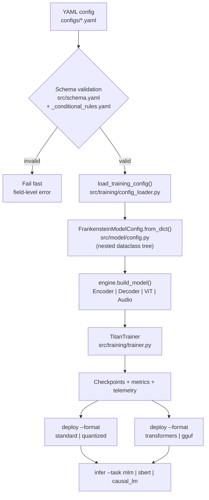
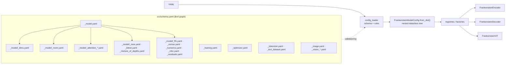
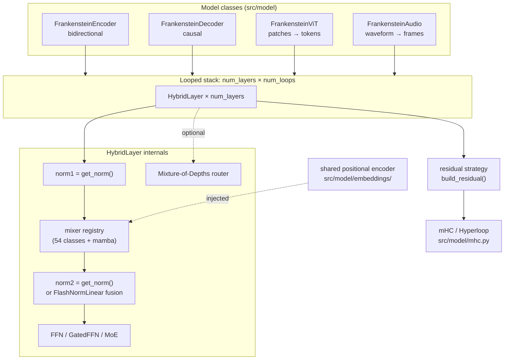
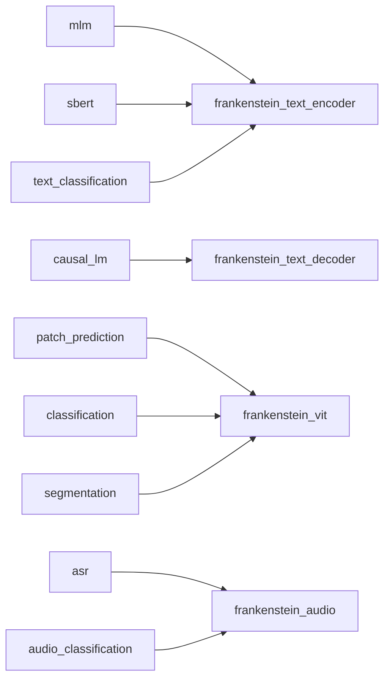
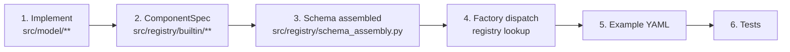

# Architecture & Extension Guide

> **Status:** canonical **implementation** specification — what the code does
> today and how to extend it. The LaTeX papers ([`docs/paper/`](paper/) and
> [`docs/paper-es/`](paper-es/)) are the source of truth for theory,
> formulations and citations; `src/schema/**` is the executable contract for
> configuration. The former `docs/specs/` directory was removed; do not
> recreate it. Agent-facing rules live in [`AGENTS.md`](../AGENTS.md),
> user-facing quickstart in [`README.md`](../README.md), and preset/optimizer
> parameters in [`configs/README.md`](../configs/README.md).

Frankenstein Transformer is a **schema-first**, configuration-driven toolkit for
experimenting with transformer sequence mixers, optimizers, normalization layers
and positional encodings without changing Python code. One strict JSON-Schema
validates a YAML file; the runtime materialises it as a nested dataclass tree
and dispatches to factories and registries. The in-repo presets must validate
cleanly; at runtime, keys the schema does not know *yet* are logged as
`[schema] … unknown key(s) ignored` warnings (see §7) instead of aborting the
load.

## 1. At a glance

| Dimension | Count | Defined in |
|---|---:|---|
| `model.dims.layer_pattern` values | **55** (54 concrete mixers + `mamba`) | `src/schema/_model/_dims.yaml` |
| Optimizer families | **38** | `src/schema/_optimizer.yaml` |
| Normalization types | **6** | `src/schema/_model/_norm.yaml` |
| Positional encodings | **12** (11 active + `none`) | `src/schema/_model/_positional_encoding.yaml` |
| FFN activations | **43** | `src/schema/_model/_ffn.yaml` |
| Model classes | **4** | `src/schema/_model_class.yaml` |
| Training tasks | **9** | `src/schema/_training.yaml` |
| Residual strategies | **4** | `src/schema/_model/_residuals.yaml` |
| Optimizer parameter groups | **10** | `src/model/optimizer/base.py` (`GROUP_NAMES`) |
| CLI subcommands | **4** | `src/cli.py` |
| Deployment formats | **4** | `src/cli.py` (`deploy --format`) |

> The schema enums are the executable contract for code. The README census
> reports the same numbers: 55 `layer_pattern` values (including the `mamba`
> placeholder) and 12 positional encodings (11 active + `none`). The
> mathematical definitions stay in the paper; this document tracks what is
> actually wired up.

## 2. System overview



The YAML file is the single source of truth for model/training settings.
`--device` is the only training runtime override; the `infer` runtime flags and
`deploy --config` are documented in §8.3.

## 3. Repository map

| Path | Responsibility |
|---|---|
| `src/cli.py` | `frankenstein-transformer` entrypoint: `train`, `deploy`, `infer`, `web-server` |
| `src/schema.yaml` | JSON-Schema entrypoint; `$ref`s every module |
| `src/schema/**` | Schema modules (model, training, optimizer, datasets, vision, audio) |
| `src/training/config_loader.py` | Schema resolution + cross-field validation + `LoadedTrainingConfig` |
| `src/model/config.py` | `FrankensteinModelConfig` nested dataclass tree (single coupling point) |
| `src/model/hybrid_layer.py` | `HybridLayer`: mixer registry, norm wiring, dense/MoE FFN dispatch, MoD, BitNet, residual hand-off |
| `src/model/frankenstein_encoder.py` | Encoder backbone (bidirectional; owns shared PE, mHC, AttnRes) |
| `src/model/frankenstein_decoder.py` | Causal decoder (forces `mode=decoder`) |
| `src/model/frankenstein_vit.py` | Vision Transformer (forces `mode=encoder`) |
| `src/model/frankenstein_audio.py` | Audio model class: log-mel/spectrogram/raw frontend, conv subsampling, ASR and classification heads (forces `mode=encoder`) |
| `src/model/mhc.py`, `src/model/hyperloop.py` | Manifold-constrained hyper-connections and loop-level variants |
| `src/model/residuals/**` | Residual strategies + factory |
| `src/model/moe/**` | MoE router scoring, load balancing, experts, shared experts, LatentMoE, hash layers |
| `src/model/numerics.py` | Fixed softmax / cross-entropy swaps (arXiv:2610.31642) |
| `src/model/attention/**` | 55 mixers (54 classes + `mamba`): `gated/`, `latent/`, `sparse/`, top-level modules |
| `src/model/norm/**` | 6 norms + factory |
| `src/model/embeddings/**` | 12 positional encodings + factorized/dynamic (EELBERT) embeddings + factory |
| `src/model/cache/**` | KV-cache manager, typed slots, capability registry, quantization codecs, eviction policies |
| `src/model/activation_function/**` | 44 activations + `ALL_ACTIVATIONS` factory |
| `src/model/optimizer/**` | 38 optimizers + registry + parameter routing |
| `src/engine.py` | Framework-neutral `build_model()` used by CLI, DashAI plugin and exports |
| `src/training/main.py`, `trainer.py` | Task dispatch and training loop |
| `src/training/streaming_mlm_dataset.py` | Streaming MLM dataset |
| `src/training/vision_dataset.py` | Vision dataset |
| `src/training/audio_dataset.py` | Audio dataset (HF `datasets` decode + char tokenizer, `DummyAudioDataset`, SpecAugment) |
| `src/training/rnnt.py`, `src/training/metrics.py` | RNN-T loss, greedy CTC/RNN-T decoders, CER; imbalance-aware classification metrics |
| `src/sbert/**` | SBERT training/inference |
| `src/deploy/**` | Quantization, deployment, HF export, GGUF export, inference |
| `src/streamlit_gui/app.py` | Schema-driven YAML builder |
| `configs/**` | Presets (`configs/*.yaml`) and smoke-tested examples (`configs/examples/*.yaml`) |
| `tests/**` | 84 files; see §12 for the gates that constrain extensions |
| `full_tests/**` | End-to-end harness (`run_e2e.py`), parameter-truth checks |

> `src/model/frankenstein_model.py` **does not exist**. It was split and a
> regression test (`tests/test_naming_conventions.py::test_shim_module_removed`)
> fails if it is recreated.

## 4. Configuration pipeline



### Top-level YAML keys

Only `training` is required. The rest are optional and cross-validated.

Unknown keys (keys not declared in `src/schema/**`) never abort a runtime
load: `config_loader` scans the document, logs one
`WARNING [schema] <path>: <location>: unknown key(s) ignored …` record per
offending object (`logger name: frankenstein.config`), and drops the key.
The in-repo presets remain strict — `tests/test_schema_consistency.py`
still fails on any unknown key. Never read an undocumented key in code: warn
and drop.

| Key | Schema module | Purpose |
|---|---|---|
| `base_model` | `_base_model.yaml` | HuggingFace model for continual pretraining; makes `model`/`model_class` optional |
| `tokenizer` | `_tokenizer.yaml` | `hf_repo` or `train_from_dataset` |
| `model_class` | `_model_class.yaml` | `frankenstein_text_encoder`, `frankenstein_text_decoder`, `frankenstein_vit` |
| `model` | `_model.yaml` | Architecture (required unless `base_model`) |
| `training` | `_training.yaml` | Task, runtime, optimizer/SBERT/heads |
| `image` | `_image.yaml` | ViT hyperparameters (required by vision tasks) |
| `vision_dataset` | `_vision_dataset.yaml` | Vision data loading |
| `text_dataset` | `_text_dataset.yaml` | HF text dataset loading |

### Configuration contract (nested)

The runtime configuration is the **nested** `model:` shape itself: there is no
nested-to-flat flattening step. `FrankensteinModelConfig`
(`src/model/config.py`) mirrors the YAML blocks with typed dataclasses
(`dims`, `norm`, `embedding`, `moe`, `bitnet`, `mixture_of_depths`, `ssmax`,
`numerics`, `ffn`, `classification_head`, `mhc`, `residuals`, `image`,
`audio`). Per-component knobs are mappings:

| Nested path | Runtime access |
|---|---|
| `model.dims.*` | `config.dims.*` |
| `model.norm.*` | `config.norm.*` (`type`, `partial_ratio`, `flashnorm_partial_ratio`, `eps`, `qk_norm.*`) |
| `model.attention.<mixer>.*` | bound through the mixer's `ComponentSpec` → `params.<leaf>` |
| `model.positional_encoding_parameters.<pe>.*` | read by the encoding builder; `use_pe.<mixer>_use_pe` toggles |
| `model.embedding.type` | `config.embedding.type` (`standard`/`factorized`/`dynamic`) |
| `model.moe/bitnet/mixture_of_depths/ssmax/numerics/ffn/…` | `config.<block>.*` |
| `model.mhc` / `model.residuals` | `config.mhc.*` / `config.residuals.*` |
| `image.*` / `audio.*` (top-level) | `config.image.*` / `config.audio.*` |

`FrankensteinModelConfig.from_dict()` builds the tree from the raw blocks and
validates the cross-field invariants (MoE anatomy, mHC × MoD exclusivity,
residual/hyperloop compatibility, audio/ViT ranges, …). There is no flat
constructor and no attribute aliasing: every read uses the nested path
(`config.dims.hidden_size`, `config.norm.type`, `config.bitnet.enabled`, …),
per-component knobs are read through the bound `ComponentParams`, and
positional-encoding knobs keep small read-only properties
(`config.rope_base`, …) that read the nested mapping.

### Component registry and plugin schema assembly

`src/registry/` is the single source of truth for every pluggable component:

```
ComponentSpec (frozen dataclass)
├── name / family / builder ("module:attr", lazily imported)
├── params_schema   (inline dict or "schema/_model/<file>.yaml#/pointer")
├── defaults        (runtime parameter defaults)
├── description / description_es / references
└── capabilities: training_free, cache, cache_implemented,
    qk_norm_supported, qk_clip_supported, is_glu, supports_ffn_fusion, …
```

`resolve_schema()` (`src/utils/schema_loader.py`) resolves `$ref`s and then
calls `src/registry/schema_assembly.py`, which injects:

* `dims.layer_pattern.items.enum` ← mixer names (+ bilingual rows for any
  component missing from the hand-written table);
* `model.attention.properties.<mixer>` ← the spec's parameter fragment
  (shared fragments such as `attention.falcon` are exposed too);
* `norm.type`, `ffn.activation`, `residuals.type`, `positional_encoding`
  (with aliases) and the new `embedding.type` enums;
* `optimizer.optimizer_class.enum`, the use-case table rows, the
  `x_parameter_reference.by_optimizer` map and one `^<name>-:` `if/then` rule
  per optimizer;
* `positional_encoding_parameters.use_pe.<mixer>_use_pe` defaults;
* the top-level `plugins:` key.

The assembled document is still closed (`additionalProperties: false`), so
plugin components validate exactly like built-ins and appear automatically in
the Streamlit builder. `frankenstein-transformer` can export the assembled
snapshot for the website mirror and CI diffs.

**Plugin loading** is layered (`src/plugins/loader.py`):

1. installed distributions exposing the `frankenstein.plugins` entry-point
   group — a failing entry point is logged and skipped;
2. the config's top-level `plugins:` list (`./plugin.py`, `pkg.module`,
   `pkg.module:register`) — failures are hard errors;
3. in-repo built-ins (`src/registry/builtin/**`), registered by importing
   `src.model` or calling `ensure_builtins()`.

A plugin registers through `src/plugins/api.py`
(`register_mixer`, `register_optimizer`, `register_norm`, …); see
`examples/plugins/window_mixer.py` and
`configs/examples/plugin_window_mixer.yaml`.

## 5. Model architecture



**Looped depth:** `L_logical = num_layers × num_loops`. Physical layers are
`num_layers`; weights are shared across loop iterations by position, so depth
grows without new parameters.

**BitNet wiring:** when `model.bitnet.enabled: true` (the default), primary and
gate `nn.Linear` layers are replaced by `BitLinear`; the FFN router and the
embedding conv follow `bitnet.routers` / `bitnet.conv`. `HybridLayer` is the only
place that chooses the projection class.

## 6. Model classes and tasks



| `model_class` | Mode | Allowed tasks | Notes |
|---|---|---|---|
| `frankenstein_text_encoder` | `encoder` or `decoder` | `mlm`, `sbert`, `text_classification` | Full mixer set, MoE, advanced norms |
| `frankenstein_text_decoder` | **forced `decoder`** | `causal_lm` | Causal masking; required by `training.task: causal_lm` |
| `frankenstein_vit` | **forced `encoder`** | `patch_prediction`, `classification`, `segmentation` | Requires `image:` block (+ `vision_dataset:` for data); patch embedding and vision heads |
| `frankenstein_audio` | **forced `encoder`** | `asr`, `audio_classification` | Requires `audio:` block (+ `audio_dataset:` for data); log-mel/spectrogram/raw frontend, conv subsampling, CTC/RNN-T/classification heads |

Cross-field rules enforced in `config_loader.py` and
`src/schema/_conditional_rules.yaml`:

- `hidden_size % num_heads == 0`.
- `num_kv_heads` divides `num_heads` (GQA/MSA/SparDA, CCGQA).
- `layer_pattern` length equals `num_layers`.
- `task: causal_lm` ⇒ `model_class: frankenstein_text_decoder`.
- Vision tasks ⇒ `model_class: frankenstein_vit`.
- Audio tasks (`asr`, `audio_classification`) ⇒ `model_class: frankenstein_audio`, with a required `audio:` block and `audio_dataset:` data (for `asr`, one with a `text_column`).
- `text_classification` ⇒ encoder.
- `base_model` requires `training` and (for MLM/causal LM) `tokenizer.name_or_path`.
- `mlm` requires `training.optimizer`; `sbert` requires `training.sbert`.
- `bitnet.routers: true` ⇒ `bitnet.enabled: true`; `bitnet.conv` only applies when BitNet and `embedding.conv.enabled` are both true.
- `norm.qk_norm.enabled: true` ⇒ every mixer in `layer_pattern` must be QK-capable (`QK_NORM_MIXERS`); `method: qk_clip` additionally requires per-head dot-product logits (`QK_CLIP_MIXERS`, excludes `gma`). Enforced in `config_loader._validate_qk_norm`.

## 7. Component reference

### 7.1 Core dimensions (`model.dims.*`)

| Field | Type | Default | Notes |
|---|---|---:|---|
| `vocab_size` | int ≥ 0 | 50000 | Must match the tokenizer |
| `hidden_size` | int ≥ 1 | 2048 | Divisible by `num_heads` |
| `num_layers` | int ≥ 1 | 12 | Physical layers |
| `num_loops` | int ≥ 1 | 2 | Logical-depth multiplier |
| `num_heads` | int ≥ 1 | 16 | Divides `hidden_size` |
| `num_kv_heads` | int ≥ 1 | 1 | GQA/MSA/SparDA/CCGQA |
| `dropout` | float [0,1] | 0.1 | Global |
| `layer_pattern` | enum array | — | Exactly `num_layers` entries |
| `mode` | `encoder` \| `decoder` | `encoder` | Forced by model class where noted |

### 7.2 Normalization (`model.norm.*`)

| `type` | Formula | Params | Notes |
|---|---|---|---|
| `layer_norm` | standard LayerNorm | γ, β | Baseline |
| `dynamic_tanh` | `tanh(α·x)` | α | DyT; normalization-free |
| `derf` | `erf(α·x + s)` | α, s | Normalization-free |
| `rms_norm` | `g·x / √(mean(x²)+ε)` | g | No mean subtraction |
| `prms_norm` | RMS over first `k = ⌈n·p⌉` dims | g | `p = norm.partial_ratio` (default 0.0625) |
| `flash_norm` | weightless RMS (`g ≡ 1`) | none | Optional partial RMS via `norm.flashnorm_partial_ratio`; fuses into the next projection when possible |

`get_norm()` in `src/model/norm/factory.py` dispatches; `prms_norm` reuses
`RMSNorm(partial_ratio=…)`, `flash_norm` uses `FlashNorm`.

**QK normalization and attention-logit control** (`model.norm.qk_norm.*`,
`src/model/norm/qk.py`) is orthogonal to `norm.type`: it stabilizes the
pre-softmax scores `QKᵀ/√d` and is selected by `qk_norm.method`.

| `method` | Mechanism | Params | Actuation point |
|---|---|---|---|
| `rms_norm` | per-head `q̂ = γ_q·q/√(mean(q²)+ε)` (same for `k`) | `γ_q, γ_k ∈ R^d_head` | forward, before dot product |
| `layer_norm` | per-head LayerNorm with gain and bias | `γ, β` per q/k | forward |
| `l2_norm` | weightless `q/‖q‖`, `k/‖k‖` | none | forward |
| `qk_clip` | per head `γ_h = min(1, τ/S_max^h)`; `W_q ← γ_h^α W_q`, `W_k ← γ_h^(1-α) W_k` | none | after every optimizer step |
| `quack` | `lr(W_q) = τ·η·‖W_k‖_init/‖W_k‖`, symmetric for `W_k` | none | before every optimizer step |

References: arXiv:2010.04245 (QK-norm), arXiv:2606.16310 (QK-norm with MLA;
this repo's MLA re-expands keys from the latent each step, so explicit QK-norm
is exact for training and cached decode), arXiv:2507.20534 (QK-Clip/MuonClip),
arXiv:2511.21377 (QuacK). The forward module is attached to each mixer that
calls `attach_qk_norm`; the training-time methods are driven by
`Trainer._qk_clip_active` / `Trainer._quack` around `optimizer.step()`.

Because the latent cache re-expands every key from the stored latent,
`cached_latent_attention` rotates the expanded key history from position 0
(only queries carry the decode offset), which keeps full-vs-cached parity
exact with QK normalization enabled.

### 7.3 Embeddings (`model.embedding.*`)

| Field | Default | Effect |
|---|---:|---|
| `factorized.enabled` | false | Embedding `V×H` → `V×R + R×H` |
| `factorized.dim` | 128 | Rank `R` |
| `dynamic.enabled` | false | EELBERT (arXiv:2310.20144): replace the lookup table with an on-the-fly n-gram hash of the token strings |
| `dynamic.ngram_max` | 3 | Maximum n-gram size `N` hashed per token |
| `dynamic.bucket` | 1000000007 | Hash bucket `B` for the rolling hash and the `[-1, 1]` fold |
| `dynamic.seed` | 42 | Random state for the `hidden_size` hash seeds (the only stored integer) |
| `dynamic.precompute` | **true** | Memoise `V×H` in a **non-persistent** buffer (never saved/exported) |
| `conv.enabled` | **true** | Causal Conv1d over token embeddings (composes with factorized/dynamic) |
| `conv.kernel` | 3 | Conv kernel size |

Dynamic embeddings are mutually exclusive with `factorized.enabled` (schema
rule + `__post_init__`). They hash token **strings**, so the config carries a
runtime-only, non-schema field `token_vocab` that the engine
(`src/utils/tokenizer_vocab.py`), deploy and inference paths inject from the
tokenizer before `build_model`; constructing `DynamicEmbedding` without it
raises. Nothing embedding-shaped enters `state_dict`, so checkpoints and the
native deploy artifacts stay small. The Transformers export materialises the
computed table as a frozen `nn.Embedding` and records a warning in the
compatibility report (HF wrappers cannot run the custom hash).

### 7.4 Sequence mixers (`model.dims.layer_pattern`)

56 enum values in 9 families. `config subkey` is the optional
`model.attention.<subkey>` object; "—" means no knobs.

| Mixer | Family | Config subkey | Train |
|---|---|---|---|
| `standard` | Dense | — | yes |
| `sigmoid` | Dense | — | yes |
| `ca` | Dense | `ca.*` | yes |
| `xsa` | Dense | — | yes |
| `mta` | Dense | `mta.*` | yes |
| `gqa` | Dense | `dims.num_kv_heads` | yes |
| `retnet` | Recurrent | `retnet.heads` | yes |
| `mamba` | Recurrent | — (linear placeholder) | yes |
| `ode` | Recurrent | `ode.solver`, `ode.steps` | yes |
| `titan` | Memory | — | yes |
| `engram` | Memory | `engram.*` | yes |
| `memory` | Memory | `dims.num_kv_heads` | yes |
| `sparse_transformer` | Sparse | — | yes |
| `longformer` | Sparse | — | yes |
| `swa` | Sparse | `swa.*` | yes |
| `bigbird` | Sparse | — | yes |
| `sparsek` | Sparse | — | yes |
| `probsparse` | Sparse | `probsparse.*` | yes |
| `nsa` | Sparse | — | yes |
| `msa` | Sparse | `msa.*` | yes |
| `sparda` | Sparse | `sparda.*` | yes |
| `sparge` | Sparse | — | yes (dense train, sparse eval) |
| `fasa` | Sparse | — | yes (dense train, sparse eval) |
| `lsa` | Sparse (semantic) | `lsa.*` | yes |
| `gla` | Gated | — | yes |
| `deltanet` | Gated | — | yes |
| `gated_deltanet` | Gated | — | yes |
| `gated_deltanet2` | Gated | — | yes |
| `hgrn2` | Gated | — | yes |
| `fox` | Gated | — | yes |
| `gated_softmax` | Gated | — | yes |
| `kda` | Gated | `kda.*` (head geometry, `decay_mode` k3, short conv) | yes |
| `fpa` | Gated | `fpa.*` | yes |
| `falcon1` | Fast-weight | `falcon.*` | yes |
| `falcon2` | Fast-weight | `falcon.*` | yes |
| `falcon3` | Fast-weight | `falcon.*` | yes |
| `falcon1a` | Fast-weight | `falcon.*` | yes |
| `falcon2a` | Fast-weight | `falcon.*` | yes |
| `falcon3a` | Fast-weight | `falcon.*` | yes |
| `mla` | Latent | `mla.latent_rank`, `mla.num_heads`, `mla.head_dim` | yes |
| `gmla` | Latent (gated) | `gmla.*` (latent rank, q-LoRA, NoPE/rope widths, output gate) | yes |
| `gqla` | Latent | `gqla.*` | yes |
| `mlra` | Latent | `mlra.*` | yes |
| `tucker` | Latent | `tucker.*` | yes |
| `kpa` | Latent | `kpa.*` | yes |
| `tpa` | Latent | `tpa.*` | yes |
| `mfa` | Latent | `mfa.*` | yes |
| `iha` | Latent | `iha.*` | yes |
| `gta` | Latent | `gta.*` | yes |
| `mtla` | Latent | `mtla.*` | yes |
| `cca` | Latent + conv | `cca.*` | yes |
| `ccgqa` | Latent + GQA + conv | `ccgqa.*` | yes |
| `gma` | Latent (Gaussian mixture) | `gma.*` | yes |
| `ssog` | Geometric field | `ssog.*` | yes (encoder, grid input) |
| `conformer` | Convolution-augmented | `conformer.*` | yes |
| `fastconformer` | Convolution-augmented | `fastconformer.*` | yes |

Inference-sparse mixers: `HybridLayer.TRAINING_FREE_LAYERS = {"fasa", "sparge"}`
run standard dense attention in `train()` mode (via `mixer.dense_forward`, sharing
the mixer's own `q/k/v/out` projections) and their sparse heuristic in `eval()`
mode. They can therefore appear in a training preset; the one-time `UserWarning`
marks the dense surrogate. See §2 (dispatch) and §9 (cache).

`swa` implements SWA($w$, $s$) from arXiv:2608.28444: every query attends
to the first `swa.num_sinks` tokens plus the `swa.window_size -
swa.num_sinks` most recent tokens (causal in decoder mode, symmetric in
encoder mode). The mask is built vectorized; there are no extra parameters
beyond the standard attention projections, and the receptive field after `l`
layers is `l·(w−s)` plus the always-visible sink prefix.

`memory` implements Memory Attention from arXiv:2609.28399: the value
projection is removed and values are `V = K + RMSNorm(E[s])`, where
`E ∈ R^{vocab_size × d_v}` is a per-layer token-ID memory table and
`d_v = num_kv_heads · head_dim`. RoPE applies to the scoring pair only (values
come from the unrotated keys); the mixer needs `input_ids` like `engram`.
Attention weights are standard softmax, so the KV cache is a plain `KVSlot`.

`lsa` implements Native-LSA from arXiv:2610.42147: keys are L2-normalised,
pooled every `lsa.pool_size` tokens and Ward-clustered per complete
`lsa.cluster_block` into `lsa.cluster_block / lsa.keys_per_bucket` buckets
whose unit-norm centroids are scored by the best query head
(`s_{i,b} = max_h q̂_h·c_b`). Each query expands the top `lsa.num_buckets`
buckets, best first, into `lsa.num_long_range` long-range keys and attends to
`lsa.num_sinks` sinks + selection + its own block (window `n_w =
lsa.cluster_block`), with one index list shared by every head. The mixer adds
no parameters, defaults `lsa_use_pe` to `false` (N-LSA trains without
positional encoding) and stops the gradient through the selection. Buckets are
immutable once a block completes, so the `BucketKVSlot` incremental branch is
exact; flat search scores about `T/keys_per_bucket` centroids per decode step.

`fastconformer` implements Fast Conformer limited-context attention from
arXiv:2305.05084 — the long-form variant of the Convolution-augmented Conformer
block: every query attends to a symmetric local window
(`fastconformer.window_size`, paper §3.4: 128 per side, i.e. 256) plus
`fastconformer.global_tokens` global attention tokens pinned at the head
positions `{0, s, …, (g−1)s}` (`s = fastconformer.global_tokens_spacing`), which
attend to everything and are attended by everything. `global_attn_separate`
gives the global token its own q/k/v projections (paper §2.2, Longformer-style,
`+3H²` parameters) instead of sharing the local ones (paper §3.4, the evaluated
long-form model). The reference implementation masks a dense score matrix; the
paper's overlapping-chunk kernel is out of scope. The mixer adds no parameters
by default, trains its windowed pattern in both train and eval, and caches in a
`RingSlot` whose pinned head prefix covers the global positions (exact decode).

`ca` implements Continuum Attention from arXiv:2610.20586: adjacent keys and
values define a piecewise-linear memory trajectory and each query retrieves by
exact normalized integration of an exponential relevance density over its
visible prefix (half-token endpoint caps included). The closed-form exponential
moments J0/J1 replace the softmax (J2 is only needed for the paper's analytic
backward); with `ca.learned_gain: true` each head learns a gain gamma = exp(rho)
initialized at `ca.gain_init` (+nH parameters per layer), while the fixed-gain
form adds no parameters. The KV cache is a plain `KVSlot`: the effective weights
are recomputed row-locally over the cached prefix each decode step (sigmoid
re-normalization precedent).

`fpa` implements First Passage Attention from arXiv:2610.22714: every head
computes a scalar field φ and a scalar level ψ per key from a shared learned
walk (the prefix sum of per-token increments), and lowers a key's logit by
β times the deepest dip of the field below the key's level,
`b_ts = β·min(0, min_{s<u≤t} φ_u − ψ_s)`. FoX is the special case of a walk
that never rises (δ ≤ 0). The mixer adds a `3·nH`-wide field projection with
bias and one learned strength β per head (`3·nH·(H+1) + nH` parameters per
layer); `fpa.beta_init` sets β's initialization (paper: 1) and `fpa.tau` the
temperature of the straight-through soft-minimum gradient (paper: 1; the
forward and eval paths always use the hard range minimum). It defaults
`fpa_use_pe` to `false` (the walk is positional) and builds the bias with a
masked flip+cummin over the `T×T` scores (the paper's fused Triton kernel is
out of scope); encoder mode symmetrises the open-span minimum, a repo-side
generalisation of the paper's causal head. Decoding is exact: the `KVSlot`
stores the per-token field and level as extras and updates
`φ̄_{t,s} = min(φ̄_{t−1,s}, φ_t)` in O(t) (Proposition 2.4b).

Registry: the local `mixer_registry` dict in `src/model/hybrid_layer.py` maps
names to classes; `mamba` is handled as a linear projection special case.

### 7.5 Positional encodings (`model.positional_encoding`)

One shared module is built by the backbone and injected into every
`HybridLayer`. Per-mixer opt-out lives under
`model.positional_encoding_parameters.use_pe.<mixer>_use_pe: false`.

| Encoding | Style | Key parameters |
|---|---|---|
| `rope` | Rotation | `rope.base` (10000), `rope.scaling` (1.0) |
| `hope` | Hyperbolic rotation | `hope.base`, `hope.damping` |
| `nope` | None | — |
| `alibi` | Score bias | `alibi.num_heads` |
| `bam` | Score bias | `bam.learn_mu`, `bam.theta_init`, `bam.eps`, `bam.mu_init` |
| `pape` | Q/K augmentation | `pape.num_parabolas`, `pape.num_positions`, `pape.rotation_invariant` |
| `pape_efficient` | Q/K augmentation | same as `pape` |
| `pape_ri` | Q/K augmentation | `pape.rotation_invariant` |
| `sinusoidal_absolute` | Additive | `sinusoidal.max_len`, `sinusoidal.base`, `sinusoidal.scale` |
| `sinusoidal_rotary` | Rotation | same as `sinusoidal_absolute` |
| `learned_absolute` | Additive | `learned.max_len`, `learned.init_std` |
| `none` | None | — |

SSMax (`model.ssmax.enabled`, `ssmax.s_init`) is a transversal logit rescale
`s·ln(n)` that composes with any encoding.

### 7.6 FFN and activations (`model.ffn.*`)

| Field | Default | Notes |
|---|---:|---|
| `hidden_size` | `null` | Defaults to `4 × hidden_size` in the model builder |
| `activation` | `silu` | 44 values (below) |
| `activation_config` | `{}` | Strict sub-object for learnable/parametric parameters |

Activation families (44): **standard** `silu`, `gelu`, `gelu_tanh`, `relu`,
`relu6`, `leaky_relu`, `prelu`, `sigmoid`, `tanh`, `softplus`, `mish`,
`hardswish`, `identity`, `softsign`, `arctan`, `elliott`; **rectified**
`abs_relu`, `nl_relu`, `brelu`, `vrelu`, `hexpo`, `ptanh`, `dis_relu`;
**exponential** `elu`, `selu`, `celu`, `pelu`, `mpelu`, `felu`, `eelu`,
`pdelu`, `preu`, `softexp`, `elish`, `hardelish`, `lisht`; **learnable**
`swish`, `swish_trainable`, `maxout`, `raf`; **gated (GLU)** `swiglu`, `geglu`,
`reglu`, `situ`.

`get_activation()` raises on GLU names; `HybridLayer` builds a `GatedFFN`
instead. `activation_config` keys: `raf_degrees`, `raf_version`, `raf_approx_func`,
`raf_trainable`, `raf_input_scaling`, `prelu_init`, `elu_alpha`, `celu_alpha`,
`swish_beta`, `leaky_relu_slope`, `pelu_alpha`, `mpelu_alpha`, `mpelu_beta`,
`felu_alpha`, `eelu_alpha`, `eelu_beta`, `pdelu_alpha`, `preu_alpha`,
`preu_beta`, `softexp_alpha`, `maxout_pieces`, `situ_beta_gate`, `situ_beta_up`.

### 7.7 Routing and quantization blocks

| Block | Keys (defaults) | Behaviour |
|---|---|---|
| MoE | `moe.enabled` (**true**), `moe.num_experts` (8), `moe.top_k` (2), `moe.expert_hidden_size` (null) | Replaces the dense FFN with routed experts; see the MoE contract below |
| Mixture-of-Depths | `mixture_of_depths.enabled` (false), `capacity_ratio` (0.5), `router_aux_loss_weight` (0.0) | Top-`capacity_ratio` tokens are updated; skipped tokens bypass the block. **Mutually exclusive with mHC** |
| SSMax | `ssmax.enabled` (false), `ssmax.s_init` (1.0) | Per-head learnable logit rescale `s·ln(n)` |
| Fixed numerics | `numerics.fixed_softmax` (false), `numerics.fixed_cross_entropy` (false) | Cancellation-free softmax/log-softmax and zero-sum-gradient hard-target CE (arXiv:2610.31642) |
| BitNet | `bitnet.enabled` (**true**), `bitnet.routers` (false), `bitnet.conv` (false) | Ternary `BitLinear` projections; routers/conv opt-in |


**Mixture of Experts (`model.moe.*`).** The block is implemented by
`src/model/moe/{router,balancing,layer}.py` and declared in
`src/schema/_model/_moe.yaml` (the executable contract). `HybridLayer` builds a
`MoELayer` only on the physical layers selected by `moe.layout`
(`moe.dense_layers` leading dense layers, then one MoE layer every
`moe.layer_frequency` layers); dense layers use `ffn_hidden_size`, MoE layers use
`moe.expert_hidden_size` (falling back to `ffn_hidden_size`).

| Group | Keys (defaults) | Behaviour |
|---|---|---|
| Router | `router.scoring` (softmax), `pre_softmax` (false), `renormalize` (true), `routed_scaling_factor` (1.0), `dtype` (float32), `jitter_eps` (0.0), `z_loss_coeff` (0.0) | softmax / sigmoid / sqrt-softplus gating, top-k renormalisation, output scale, fp32 router, ST-MoE z-loss |
| Routing | `routing.type` (token_choice), `capacity_factor` (0.0), `hash_layers` (0), `hash_table` (random), `hash_seed` (42) | token or expert choice, dropless/capacity dropping, fixed token-id tables |
| Balancing | `balancing.aux_loss` (batch), `aux_loss_coeff` (0.01), `bias_update` (none), `bias_update_rate` (0.001) | batch/sequence auxiliary loss and the auxiliary-loss-free expert bias (`sign`, `centered_sign`, `quantile`; Quantile Balancing ignores `bias_update_rate` and applies per micro-batch) |
| Shared | `shared.count` (0), `shared.hidden_size` (null), `shared.gate` (none) | always-on experts, optional sigmoid gate |
| Latent | `latent.enabled` (false), `latent.dim` (null), `latent.norm_before_up_proj` (false) | LatentMoE `d -> ℓ -> d` projections (Kimi K3 RMSNorm before the up-projection) |
| Experts | `experts.activation_clamp` (0.0) | upper bound on each expert's gated intermediate |

Cross-key rules (runtime, `FrankensteinModelConfig.__post_init__`):
`top_k <= num_experts`; softmax at `top_k=1` auto-enables `pre_softmax` (a
post-softmax top-1 weight has no gradient); `bias_update` requires sigmoid or
sqrt-softplus scoring; expert choice is self-balancing and forbids the
auxiliary loss and the bias; hash layers require token choice and forbid the
bias; `latent.dim` must lie in `(0, hidden_size)`; the layer layout must leave at
least one MoE layer. Per-layer diagnostics (`moe_load_balancing_loss`,
`moe_router_z_loss`, MaxVio, routing entropy, expert-norm ratio, dropped
fraction) are aggregated by `aggregate_moe_aux_losses()` into
`last_auxiliary_losses` / `last_moe_stats`, added to the task loss by the
trainer, and logged to the CSV callback and W&B. The expert bias is advanced
once per optimizer step by `update_moe_expert_bias()`.

**Fixed numerics (arXiv:2610.31642).** `numerics.fixed_softmax` swaps every
explicit softmax/log-softmax (all attention mixers, MoE/MoD routers, AttnRes
depth-wise softmax, KV-cache recompute paths and decoder sampling) for
`src/model/numerics.py::fixed_softmax`, which excludes the argmax logit from
the log-sum-exp and combines the margin with `softplus`. Forward values are
mathematically identical; the backward pass keeps the argmax softmax Jacobian
at its true magnitude `~e^{-m}` past the dtype's precision cliff (≈5.5 bf16 /
16.6 fp32 / 36.7 fp64), where the standard implementation rounds it to zero
(Softmax Collapse). `numerics.fixed_cross_entropy` swaps the hard-target task
losses (mlm, causal_lm, classification, segmentation, text_classification,
patch_prediction) for `fixed_cross_entropy`, whose target gradient equals
minus the sum of the non-target gradients by construction, so the gradient
sums to zero at any margin. The helper takes a `class_dim` argument (`-1` for
token/patch heads `(..., vocab_size)`, `1` for dense per-pixel heads
`(B, C, H, W)`); the trainer forwards it so segmentation CE matches
`F.cross_entropy`'s class axis. Soft-target/distillation CE (Softmax Cancellation)
is not used by this codebase and is therefore out of scope. The internal SSOG
LSE kernels keep their own formulation. `HybridLayer` attaches the resolved
flag as `mixer.use_fixed_softmax`; the residual factory does the same for
AttnRes modules, mirroring the SSMax `getattr` pattern.

### 7.8 Residuals, mHC and Hyperloop (`model.residuals.*`, `model.mhc.*`)

| `residuals.type` | Module | Semantics |
|---|---|---|
| `standard` | `StandardResidual` | `x + f(x)` |
| `none` | `NoResidual` | No residual sum |
| `full_attn` | `FullAttentionResidual` | AttnRes over all previous layers (`init_query_zero`, `use_rmsnorm_keys`) |
| `block_attn` | `BlockAttentionResidual` | AttnRes over `num_blocks` groups (`block_attn.*`) |

mHC (`model.mhc.enabled`, expansion rate 4, Sinkhorn iterations 20) maintains
`n` residual streams instead of one. Hyperloop (`mhc.hyperloop`) moves the
hyper-connections to loop level, which makes MoD compatible again. Residual
options: `residuals.mhc_stream_mode` (`independent`/`joint`) and
`residuals.gradient_checkpoint`.

### 7.9 Classification head (`model.classification_head.*`)

| Field | Default | Notes |
|---|---:|---|
| `enabled` | false | Adds a sequence-level head; used by `text_classification` |
| `num_labels` | `null` | Required when enabled |
| `pooling_mode` | `cls` | `cls` or `gap` |

### 7.10 Engram knobs (`model.attention.engram.*`)

| Field | Default |
|---|---:|
| `max_ngram_size` | 3 |
| `n_heads_per_ngram` | 4 |
| `embed_dim_per_head` | 32 |
| `kernel_size` | 4 |
| `seed` | 42 |

Hidden width = `(max_ngram_size − 1) × n_heads_per_ngram × embed_dim_per_head`.

### 7.11 Vision Transformer (`image.*`, `vision_dataset.*`)

`frankenstein_vit` splits the image into patches, embeds them, adds positional
information and runs the same `HybridLayer` stack. It forces `mode: encoder`
and requires the top-level `image:` block; supervised tasks also require
`vision_dataset:`.

| `image.*` field | Default | Notes |
|---|---:|---|
| `image_size.{height,width}` | — | Required |
| `patch_size` | 16 | Patch edge |
| `in_channels` | 3 | RGB |
| `to_grayscale` | false | Collapse channels |
| `pos_embedding_type` | `learned_1d` | Unified with the PE enum; `learned_1d` → `learned_absolute` |
| `cls_token` | true | Prepend a CLS token |
| `pooling_mode` | `cls` | `cls` or `gap` |
| `mask_ratio` | 0.5 | Masked-patch pre-training |
| `mask_token_strategy` | `bert` | `bert`, `mask_only`, `random_only` |
| `prediction_target` | `mean_color_3bit` | `mean_color_3bit`, `downsampled_3bit`, `full_patch_l2` |
| `seg_head_type` | `pixel` | `pixel` or `eomt` |
| `num_classes` | `null` | Classification head width |
| `num_seg_classes` | 21 | Segmentation classes |
| `seg_num_queries` | 100 | EoMT queries |
| `seg_l2_blocks` | 3 | EoMT L2 blocks |
| `seg_mask_annealing` | true | EoMT mask annealing |

| `vision_dataset.*` field | Default | Notes |
|---|---:|---|
| `dataset_name` | — | HuggingFace dataset identifier |
| `dataset_dir` | `null` | Local fallback |
| `image_column` | `image` | Column name |
| `label_column` | `label` | Classification |
| `segmentation_column` | `segmentation_map` | Segmentation |
| `rescale.{height,width}` | — | Required resize target |
| `normalize.{mean,std}` | — | Optional normalization |
| `augmentations.{random_crop,horizontal_flip,color_jitter,mixup_alpha}` | — | Training augmentations |

Tasks: `patch_prediction` (autosupervised pre-training), `classification`
(image labels), `segmentation` (`pixel` or EoMT).

### 7.12 SBERT (`training.sbert.*`)

SBERT reuses the encoder backbone with a pooled sentence-embedding objective.
It is selected by `training.task: sbert` and configured under `training.sbert`.

| Field | Default | Notes |
|---|---:|---|
| `dataset_name` | — | HuggingFace dataset |
| `dataset_type` | — | `paired_similarity`, `triplets`, `qa` |
| `columns.sentence1/sentence2/similarity` | — | Paired-similarity columns |
| `columns.query/positive/negatives` | — | Triplet columns |
| `columns.question/answer` | — | QA columns |
| `query_prefix`, `document_prefix` | `null` | Instruction prefixes |
| `output_dir` | — | Checkpoint destination |
| `pooling_mode` | — | `mean`, `cls`, `max` |
| `optimizer.optimizer_class` | — | Same 36-family enum (`$ref` to `_optimizer.yaml`) |
| `batch_size`, `num_epochs`, `learning_rate`, `warmup_steps` | — | Training schedule |
| `evaluation_steps`, `checkpoint_save_steps`, `resume_from_checkpoint` | — | Checkpointing |
| `use_amp`, `trust_remote_code`, `resample_balanced`, `standardize_scores` | — | Runtime options |

Inference: `infer --task sbert --mode similarity|search|cluster ...`.

### 7.13 KV cache and incremental decoding (`inference.*`)

Opt-in KV-cache infrastructure for autoregressive decoding. The package
lives in `src/model/cache/` and is enabled by `inference.kv_cache.enabled`
(default `false` — the legacy full-recompute path stays bit-identical).

**Architecture (D1).** One central `FrankensteinCache` manager
(HF `past_key_values`-style) is threaded
`decoder → encoder → HybridLayer → mixer` as an optional keyword argument.
Slot identity is the global `logical_layer_idx` (D6 — correct under
`num_loops`/Hyperloop where the same physical layer executes with distinct
logical roles). Per-layer storage is typed:

| Slot | Kind | Stores | Used by |
|---|---|---|---|
| `KVSlot` | `kv` | post-RoPE K/V `(B,H_kv,T,D)`, absolute `positions`, per-token `extras` | quadratic softmax mixers |
| `LatentKVSlot` | `latent_kv` | named latent streams (`c_kv`, `k_rope`, grouped keys + latent values) | latent family |
| `StateSlot` | `state` | fixed recurrent matrix (+ gate accumulators), updated in place | recurrent/linear family |
| `RingSlot` | `ring` | capacity-bounded K/V with pinned sinks | sliding-window family |
| `ConvTailSlot` | `conv_tail` | last `kernel-1` pre-conv rows | falcon/CCA (future) |
| `TokenTailSlot` | `token_tail` | last `n` token ids | engram |

**Capability registry (D5).** `src/model/cache/capabilities.py` re-exports the
per-mixer `CacheSpec` declared on each registry `MixerSpec` (55 built-ins) and
derives its `CACHE_SPECS` map from the registry. A layer caches only when
the spec says `supported` **and** the mixer is in `IMPLEMENTED_MIXERS`
(incremental branch implemented + parity-tested). Everything else receives
`cache=None` and runs the legacy path — **inference never fails because of
the cache**; `config_loader` warns about the fallback mixers. Two special
cases sit beside the registry: `engram` is admitted directly by
`is_cacheable()` (the manager's `TokenTailSlot` always provides the token
tail), and `mamba` is listed in `IMPLEMENTED_MIXERS` only as a stateless
passthrough — there is nothing to cache, so it is excluded from the parity
parametrization.

Implemented cached branches (parity-tested in
`tests/test_kv_cache_mixers.py`): `standard`, `gqa`,
`sigmoid`, `ca`, `gated_softmax`, `titan`, `fox`,
`mla`, `mfa`, `gqla`, `mlra`, `tucker`, `iha`,
`gta`, `swa`, `longformer`, `bigbird`,
`sparse_transformer`, `fasa`, `retnet`,
`gla`, `deltanet`, `gated_deltanet`,
`gated_deltanet2`, `hgrn2`, `kda`, `gma`, `memory`,
`probsparse` (`KVSlot`: query-side selection is degenerate for a single
decode query, so dense-over-cache is exact with the `U_1`/`U_2` row terms),
`mta` (`KVSlot` + per-token query tail: the causal `cq`-row score window is
rebuilt each step, exact), `lsa` (`BucketKVSlot`: KV + immutable per-block bucket centroids/index
table, never quantized), `fastconformer` (`RingSlot`: pinned head prefix
covers the global tokens), `fpa` (`KVSlot` + two per-token scalars, exact by
Prop. 2.4b of arXiv:2610.22714).
Documented fallbacks: `mamba` (stateless placeholder — nothing to cache),
`ssog`/`conformer` (`supported=False`, never cached), `ode` (solver
re-derives all intermediate states each step), `falcon*` (chunk-parallel
rehearsal FIFO), `cca`/`ccgqa` (conv tails),
`nsa`/`msa`/`sparda`/`sparge` (chunk-level block
statistics are not row-local), `mtla` (dynamic merge schedule),
`sparsek` (policy in F4), plus every PaPE-configured layer (D10).

**Positional encodings (§8 of the plan).** RoPE/HoPE/sinusoidal-rotary
accept `position_offset` (blocker B1); ALiBi/BAM accept
`bias(q_len, kv_len, q_offset, kv_positions)` (B2); SSMax rescales by
`ln(kv_len)` (B6). Absolute PEs receive `position_offset` in `add()`.
Keys are stored **post-RoPE** (D7); the slot versions `rope_scaling`.

**Quantization (F3, D3).** Write-time codecs in `src/model/cache/quant/`:
`none`, `int8` (KIVI asymmetric axes: K per-channel, V per-token),
`int4_kivi` (group-wise int4 + protected full-precision window + pinned
sinks). Recurrent states are never quantized (D12). Future codecs are
interface-ready but not implemented (`int2_kivi`, `palu_lowrank`,
`commvq`, `qjl_sketch`, `block_gtq`).

**Compression (F4).** Read-time policies in
`src/model/cache/compress/`: `none`, `window_sinks` (StreamingLLM:
pinned sinks + sliding window). Future: `h2o`, `snapkv_prefill`,
`pyramid`, `sparsek`-as-policy.

**Mechanism interactions.** MoD runs forced-dense at prefill when caching
(D8; ragged caches out of scope); decode degenerates to dense. mHC
n-streams and Hyperloop loop streams are per-token (no cross-step carry).
AttnRes residuals disable caching per forward with a warning until the
incremental buffer mode lands.

**`generate()` (D12).** With `use_cache=False` the legacy O(S²) loop runs
bit-identically. With `use_cache=True`: one prefill forward builds the
cache, then each step feeds only the last token. `greedy`, `top_k`,
`top_p` are supported; `truncate()` provides cheap rollback.

**CLI.** `infer --task causal_lm` with `--prompt`,
`--max-new-tokens/--temperature/--top-k/--top-p/--greedy`,
`--kv-cache/--no-kv-cache`, `--kv-quant`, `--kv-group-size`,
`--kv-protected-window`, `--kv-compress`, `--kv-num-sinks`,
`--kv-window`, `--config` (see §8.3).

**Deploy.** `ModelDeployer` serialises the resolved `InferenceConfig`
into `config.json` (`"inference": {...}`); the HF export's
`FrankensteinForCausalLM` now accepts `past_key_values`/`use_cache`/
`cache_position` (blocker B7).

### 7.14 Audio (`audio.*`, `audio_dataset.*`)

`frankenstein_audio` turns waveforms into frames and runs the same
`HybridLayer` stack as the text encoder. It forces `mode: encoder`
(bidirectional, symmetric convolution padding) and is required by
`training.task: asr | audio_classification`; see Annexes 17–18 of
[`docs/paper/`](paper/) for the theory. ASR head knobs live under `audio.*`
(the `asr_*` prefix); an optional `training.asr.loss` block overrides
`audio.asr_loss` for presets that only want to switch the loss (the value
must still match the head built from the model block).

| `audio.*` field | Default | Notes |
|---|---:|---|
| `feature` | `logmel` | `logmel`, `spectrogram`, or `raw` (multichannel 1-D signals such as EEG/EMG) |
| `sample_rate` | 16000 | Turns `window_ms`/`stride_ms` into samples |
| `n_mels` | 80 | Mel bins (`logmel` only) |
| `window_ms` / `stride_ms` | 25 / 10 | Hann window and hop |
| `n_fft` | 400 | STFT size; must cover the window (`25 ms × 16 kHz`) |
| `in_channels` | 1 | Channel count of the input map (`raw` sets it to the sensor count) |
| `conv_channels` | 32 | Channels of the two stride-2 `Conv2d(3×3)` subsampling stages (fixed 4× reduction) |
| `pooling_mode` | `gap` | `gap` or `cls`; used by `audio_classification` |
| `num_classes` | 2 | Classification head width |
| `asr_loss` | `ctc` | `ctc` or `transducer` (RNN-T) |
| `asr_decoder_dim` | 320 | RNN-T prediction-network width (paper: 320/640/640 for S/M/L) |
| `asr_decoder_layers` | 1 | LSTM predictor depth (kept shallow for the O(T·U) lattice) |
| `asr_decoder_dropout` | 0.1 | Predictor dropout |
| `spec_augment.enabled` | `false` | Frequency/time masking (no time warping); applied in the frontend, training only |
| `spec_augment.freq_mask_width` | 27 | Paper value `F` |
| `spec_augment.time_masks` | 10 | Paper value `m_T` |
| `spec_augment.time_mask_ratio` | 0.05 | Paper value `p_S` |

| `audio_dataset.*` field | Default | Notes |
|---|---|---|
| `dataset_name` / `dataset_dir` | `""` | HuggingFace dataset id, or a local audio directory; both empty ⇒ `DummyAudioDataset` |
| `split` | `train` | Dataset split |
| `audio_column` | `audio` | Audio column; decoded to arrays |
| `text_column` | `text` | Transcript column (required by `asr`) |
| `label_column` | `""` | Label column (`audio_classification`; required there) |
| `max_duration_sec` | 30.0 | Clips longer than this are skipped/truncated |
| `resample` | `true` | Resample decoded audio to `audio.sample_rate` |

`torchaudio` is an optional `audio` extra: the frontend uses
`torchaudio.transforms` when importable and otherwise a pure-PyTorch
`torch.stft` + mel filterbank fallback, so CPU CI stays torchaudio-free.
The HuggingFace and GGUF exports reject audio artifacts explicitly;
`standard`/`quantized` work.

## 8. Training runtime

### 8.1 Optimizers (38)

`training.optimizer.optimizer_class` selects a family; SBERT uses
`training.sbert.optimizer.optimizer_class` with the same enum.

| Family | Class | Character |
|---|---|---|
| SGD | `sgd`, `sgd_momentum` | Baselines; plain mini-batch update and momentum/nesterov |
| AdamW | `adamw` | Default, decoupled weight decay |
| Memory-efficient | `adafactor`, `lion`, `galore_adamw`, `apollo`, `apollo_mini`, `q_apollo`, `adam_pm` | Factored/low-rank/quantized state; `adam_pm` pools adjacent second-moment entries into group means, shrinking the V-state to `1/s` while keeping Adam's hyperparameters |
| Auto-LR | `prodigy`, `schedulefree_adamw` | Remove LR tuning/scheduling |
| Adaptive | `rmsprop`, `radam`, `adan`, `adopt`, `ademamix`, `mars_adamw`, `cautious_adamw`, `lamb` | Rectification, Nesterov, dual EMA, variance reduction, masking, layer-wise scaling; `rmsprop` is the classical squared-gradient running average (slides' 0.9/0.1 split), the Adam ancestor |
| Second-order | `sophia`, `shampoo`, `soap` | Diagonal Hessian / Kronecker / eigenbasis |
| Orthogonalized | `muon`, `turbo_muon`, `af_muon`, `ada_muon`, `dion3`, `root`, `muon2`, `nor_muon`, `conda`, `tuon`, `namo`, `namo_d` | Momentum orthogonalization; `muon`/`turbo_muon` follow the hybrid recipe (Newton-Schulz on hidden-layer 2-D matrices, decoupled AdamW on the `embeddings`/`pos`/`head` groups and on every non-2-D parameter, using the group `betas`/`eps`); `muon-per_head` + `muon-per_head_heads` orthogonalize each Q/K/V (and latent `uk_proj`/`uv_proj`) head block separately, and `muon-clip_value` adds K2-style element-wise weight clipping; `ada_muon` adds an element-wise second moment on the orthogonalized direction with RMS-aligned Adam-scale updates; `af_muon` adds a capped-row LMO for the vocabulary table and RMS updates for vectors (AdamW-free, a single first-moment buffer); `dion3` orthogonalizes only a fraction of the momentum rows with Gram Newton-Schulz and error feedback (single momentum buffer, optional NorMuon row moments); `root` calibrates the Newton-Schulz coefficients per matrix shape and soft-thresholds momentum outliers before orthogonalization (single momentum buffer, dynamic percentile threshold `quantile`); `muon2` preconditions the momentum with an Adam-style second-moment EMA before orthogonalization (β₁/β₂ from the shared per-group `betas`, `η√(m/n)` update scale, `factored` toggles the Muon²-F row/column moments); `nor_muon` normalizes the orthogonalized update neuron-wise (a per-row second-moment EMA of `O_t`, β₂ from the shared per-group `betas`, ε from the shared `eps`, update rescaled to RMS `0.2η` via `η̂ = 0.2η√(mn)/‖O_t‖_F`); `conda` runs a full Adam update inside the lazy SVD subspace of the first moment (second moment of the projected gradients, refreshed every `update_proj_gap` steps, `scale` multiplier; every 2-D parameter takes this path and only non-2-D parameters use the decoupled AdamW fallback); `tuon` stacks same-shape hidden matrices of a group, mixes them with a unitary layer transform (DecorQ: eigenvectors of the layer Gram matrix, refreshed every `refresh_interval` steps), polarizes each transformed slice with Newton-Schulz, inverts the transform and rescales the stack to RMS 1/√max(m,n) (`K=1` buckets reduce to `muon`; the AdamW fallback is unchanged); `namo` rescales the orthogonalized momentum by a single Adam-type scalar α_t = ‖M̂_t‖_F/(√v̂_t+ε) built from a scalar second-moment EMA of ‖G_t‖²_F (μ₁/μ₂ from `namo-betas`, ε from the shared `eps`, decoupled decay scaled by α_t, one scalar of extra state); `namo_d` right-multiplies the orthogonalized momentum by a clamped diagonal built from per-column second moments and column norms (`namo_d-clamp` c ∈ (0,1], default 0.1, `d̃ = clamp(d, c·d̄, d̄/c)`), giving neuron-wise adaptivity at the cost of strict orthogonality and one ℝⁿ vector of extra state |
| Tunable | `anon` | `gamma` adaptivity |
| Evolutionary | `eve`, `ea4llm` | Population-based, closure-based step; `eve` is population-of-4 differential evolution with a targeted Adam fallback (12× state), `ea4llm` is gradient-free Gaussian evolution strategies with zero optimizer state and N forward evaluations per step (both require `gradient_accumulation_steps: 1` and are unavailable for SBERT) |

**Parameter groups:** `embeddings`, `pos`, `attention`, `ffn`, `norms`,
`head`, `mhc`, `router`, `residual`, `other`. The taxonomy is the same one
used by the parameter estimator and the `grad_norm_<block>` logs
(`src/utils/param_categories.py`; `norm` maps to the historical plural
`norms`). Mixer parameters — including nested QK-norms and ODE/RetNet/Mamba
state — route to `attention`; MoE experts route to `ffn`, routers to
`router`, and task heads to `head`. Grouping is shared by the trainer and
`FrankensteinViT.configure_optimizers` through
`src.model.optimizer.base.categorize_param_groups`.

**Prefix contract:** `<optimizer_class>-<group>_<param>` for per-group keys
(`adamw-lr_embeddings`, `muon-lr_attention`, …) and
`<optimizer_class>-<param>` for global optimizer keys (`muon-ns_steps`,
`sgd_momentum-momentum`, `q_apollo-quant_bits`). The schema's
`x_parameter_reference.by_optimizer` lists every prefix and allowed suffix;
`factory.OPTIMIZER_ALLOWED_KEYS` rejects anything else.

### 8.2 Runtime safety

`training.*` exposes AMP, gradient accumulation/clipping, scheduler selection
(`cosine`, `constant`, `linear_warmup_then_constant`), rolling checkpoints,
NaN retries, CSV/NVML telemetry, the GPU thermal guard (`gpu_temp_*`), and
optional GaLore settings. The guard pauses at `gpu_temp_pause_threshold_c`
(default 90 °C) and resumes at `gpu_temp_resume_threshold_c` (80 °C).

**Reproducibility.** `training.seed` (int, default `42`) seeds the Python,
NumPy, PyTorch and CUDA RNGs, model weight initialization (the entrypoints
seed before constructing the model), every `shuffle=True` DataLoader through a
dedicated `torch.Generator`, DataLoader workers, the held-out split
permutation, and the SBERT dataset shuffle. It also exports `PYTHONHASHSEED`
for the thermal-supervisor child re-launch. CUDA runs set
`cudnn.deterministic=true` / `cudnn.benchmark=false` (throughput may drop,
but repeated runs on the same hardware/software stack are reproducible);
`torch.use_deterministic_algorithms` is intentionally not enabled because
several CUDA kernels raise on it. Implemented in
`src/utils/reproducibility.py` (`set_global_seed`, `make_generator`,
`seed_worker`) and applied by `engine._train_from_config_path`,
`training/main.py::main` and the SBERT entrypoint.

**Held-out test split.** `training.test_percentage` (float, 0–100, default 0)
reserves a deterministic fraction of the task dataset before training (seeded
permutation driven by `training.seed`, so the same config always holds out the
same examples) and evaluates the final weights on it after the last epoch.
Classification tasks (`classification`, `text_classification`,
`audio_classification`) are **stratified by default** (`training.test_stratify`,
bool, default true): each class keeps approximately the same share in both
partitions and every class with at least two examples receives a test example
when the budget allows it, so rare classes are not swallowed by one side. The
exact indices are persisted as `test_split.json` next to the metrics. The
trainer's `evaluate()` reuses the training objective through `no_grad` and
weights loss/accuracy by supervised units (masked tokens for MLM, shifted tokens
for causal LM, masked patches, pixels or examples), so token/pixel tasks are no
longer sample-weighted. For classification it adds balanced accuracy,
macro/weighted precision/recall/F1, per-class metrics and the confusion matrix;
for segmentation it adds pixel-level macro-F1 and mean IoU; for MLM/causal LM it
adds perplexity. `src/training/test_split.py` writes `test_metrics.json` next to
the CSV log (`task`, `metric`, `test_percentage`, `num_train_samples`,
`num_test_samples`, `test_loss`, `test_accuracy`, `test_macro_f1`,
`test_balanced_accuracy`, `test_weighted_f1`, `stratified`, `primary_metric`,
per-class metrics, confusion matrix, `num_batches`). It covers MLM, causal LM, text classification,
the three vision tasks, ASR (the `test_accuracy` slot carries the CER and
`metric` is `cer`) and audio classification; SBERT keeps its own validation
split via `training.sbert.max_eval_samples`. Wired in `engine.py`
(text/vision/audio) and `training/main.py` (CLI audio path);
`full_tests/run_e2e.py` reports the values in `results.json` and the
`results.md` `test_acc`/`test_f1` columns, and its inference evaluation reuses
`test_split.json` so deploy/quantized/HF accuracy is measured on the held-out
examples.

**Host CPU/RAM telemetry.** `system_metrics_enabled: true` (default) makes every
logged step record the host side of the run, on CPU and CUDA alike, because the
host is the shared resource when several workers run in parallel: the training
process (`cpu_percent`, `cpu_cores`, `cpu_threads`, `cpu_rss_mb`,
`cpu_rss_peak_mb`, `cpu_thread_hot_pct`) and the whole machine
(`sys_cpu_percent`, `sys_ram_used_pct`, `sys_ram_used_gb`, `sys_ram_avail_gb`,
`sys_swap_used_pct`, `sys_load_1m`). `system_metrics_thread_breakdown: true`
(default) adds the busiest single thread from `/proc/self/task/<tid>/stat`,
which shows whether the `OMP_NUM_THREADS`/MKL thread pool is actually being used
or one thread is doing all the work. Implemented in
`src/training/system_telemetry.py`; the values are also forwarded to the
`metrics_callback` payload and to W&B as `system/<column>`. The columns are
appended to the existing CSV schema, so an older metrics file rotates under
`csv_rotate_on_schema_change`. `full_tests/run_e2e.py` complements this with a
1 Hz `results/system_telemetry.csv` (machine totals plus the summed RSS of every
live child), and `--omp-threads`/`--env` export the thread variables into every
subprocess.

**Per-block gradient norms.** With `enable_block_grad_norms: true` (default),
each logged step records the L2 gradient norm of every canonical parameter
block — `embeddings`, `pos`, `attention`, `ffn`, `norm`, `head`, `mhc`,
`router`, `residual`, `other` — as `grad_norm_<block>` CSV columns and in the
`metrics_callback` payload. The taxonomy is defined once in
`src/utils/param_categories.py` and shared with
`full_tests/param_count_check.py`, so it matches the website parameter
estimator breakdown. Mixer-internal norms (QK-norm, GroupNorm) count as
`attention`; MoE experts count as `ffn`, exactly as in the estimator. The
legacy CSV schema (which had `experts`/`ode`/`retnet`/`mamba`/`norms` columns)
rotates automatically under `csv_rotate_on_schema_change: true`.

**Weights & Biases.** `training.wandb_project` (unset by default) enables W&B
step logging; `training.wandb_mode` is `online`/`offline`/`disabled`. When
`enable_block_grad_norms` is also true, each block is logged as
`grad_norm/<block>` alongside loss, LR, `grad_norm`, clip ratio, step time,
tokens/s and GPU telemetry. W&B lives in the optional `wandb` extra
(`pip install -e ".[wandb]"`); without it, a configured project emits a
one-time warning and training continues.

### 8.3 CLI surface

The CLI exposes exactly four subcommands. `--device` is the only runtime
override for training; the `infer` subcommand additionally accepts
generation/KV-cache flags (CLI > YAML `inference:` > schema default).

| Subcommand | Key flags | Behaviour |
|---|---|---|
| `train` | `--config`, `--config-name`, `--device`, `--list-configs` | Validates and trains (MLM, SBERT, causal LM, vision, text classification, ASR, audio classification) |
| `deploy` | `--checkpoint`, `--output`, `--format`, `--yaml`, `--config`, `--validate`, `--check`, `--quant`, `--quant-runtime`, `--device` | `standard`/`quantized` artifacts; `transformers`/`gguf` exports. `--config` is a JSON model config for `standard`/`quantized` only. |
| `infer` | `--model`, `--task {mlm,sbert,causal_lm}`, `--mode`, `--config`, `--device`, `--batch-size`, `--fp16`, `--benchmark`, `--benchmark-generation`, `--text`, `--input`, `--output`, `--sentence1`, `--sentence2`, `--query`, `--corpus-file`, `--sentences-file`, `--input-file`, `--output-file`, `--top-k`, `--n-clusters`, `--prompt`, `--max-new-tokens`, `--temperature`, `--top-p`, `--greedy`, `--kv-cache/--no-kv-cache`, `--kv-quant`, `--kv-group-size`, `--kv-protected-window`, `--kv-compress`, `--kv-num-sinks`, `--kv-window` | MLM, SBERT or autoregressive generation (with optional KV cache) |
| `web-server` | `--server-port`, `--server-address`, `--server-headless`, `--development-mode` | Streamlit schema-driven YAML builder |

`--format transformers|gguf` requires `--yaml`; `--check` is only valid with
`gguf`; `deploy --config` is rejected for export formats. `infer --task
causal_lm` requires a decoder artifact (`config.mode == "decoder"`); every
generation/cache flag defaults to `None` (no override).

## 9. Data paths

| Path | Builder | Task |
|---|---|---|
| Tokenizer `hf_repo` | `src/tokenizer/**` | all text tasks |
| Tokenizer `train_from_dataset` | `src/tokenizer/train_tokenizer.py` + `text_dataset` | MLM/causal LM with a custom vocab |
| Streaming MLM | `src/training/streaming_mlm_dataset.py` | `mlm` |
| HF text dataset | `src/training/text_dataset_builder.py` | `mlm`, `text_classification` |
| SBERT datasets | `training.sbert` (`paired_similarity`, `triplets`, `qa`) | `sbert` |
| Vision dataset | `src/training/vision_dataset.py` | `patch_prediction`, `classification`, `segmentation` |
| Audio dataset | `src/training/audio_dataset.py` (HF `datasets` decode or `DummyAudioDataset`) | `asr`, `audio_classification` |
| Held-out test split | `src/training/test_split.py` (`training.test_percentage` + `test_stratify` → `test_metrics.json` / `test_split.json`) | all tasks except `sbert` |

## 10. Deployment and export

`frankenstein-transformer deploy` accepts four formats:

| Format | Output | Requires `--yaml` |
|---|---|---|
| `standard` | FP32 checkpoint | no |
| `quantized` | BitNet ternary / compact artifact | no |
| `transformers` | HuggingFace `config.json` + `model.safetensors` + `modeling_*.py` (+ optional `--quant q8_0\|q4_0\|i2_s`, `--quant-runtime dequantize_on_load\|quantized_linear`) | yes |
| `gguf` | GGUF file (BitNet), `--check` supported | yes |

`infer` runs MLM/SBERT inference against a deployed artifact. The HuggingFace
export is compatibility-checked against the YAML before writing anything; SBERT
and audio artifacts are rejected explicitly (no upstream mapping).

The HF artifact is safetensors-only: `q8_0` (8.5 bpw) and `q4_0` (4.5 bpw)
store 32-weight affine blocks, `i2_s` (2.0 bpw) stores BitNet ternary values,
all with the packed payloads in `model.safetensors` and the per-tensor map in
`config.json` (`frankenstein_quantization`). `dequantize_on_load` (v1) expands
blocks into fp32 parameters at load time; `quantized_linear` (v2) keeps
`PackedLinear` buffers packed and dequantizes in `forward`. No
`pytorch_model.bin` or bitsandbytes runtime is involved.

The generated `configuration_frankenstein.py` keeps the nested `model:` block
under `frankenstein_config` (the authoritative copy) and never mirrors model
keys into reserved HF properties: the wrapper rebuilds the config with
`FrankensteinModelConfig.from_dict`. A `null` `num_labels` is omitted from
`config.json`, and the RoPE scaling factor stays inside the nested
`positional_encoding_parameters` mapping where transformers' own
`rope_scaling` validation cannot reject it.

## 11. Extending the software

Every pluggable component follows one recipe: implement, declare a
`ComponentSpec`, add an example, run the gates. The schema enum/tables,
registries, factories, Streamlit pickers and e2e harness derive from the spec.



### 11.1 Add or change a component (any family)

1. Implement the module. Constructor/builder contracts:
   * mixer — `builder(config, pos_encoder=None, params=None)` returning the
     mixer; `forward(x, logical_layer_idx=None, pos_encoder=None)`;
   * optimizer — `torch.optim.Optimizer` subclass taking `(param_groups, **kwargs)`;
   * norm — `builder(config, params)`; activation — `builder(config, params, dim)`;
   * residual — `builder(config, params)`; PE — `builder(config, params)`;
   * embedding — `builder(config, params)`.
2. Add a spec in `src/registry/builtin/<family>.py` (built-in) or call the
   matching `register_*` from `src/plugins/api.py` (plugin). The spec carries
   the name, lazy builder, parameter fragment, defaults, bilingual description
   and capability flags.
3. Add `configs/examples/<family>_<name>.yaml` when user-facing. For plugins,
   list the module under the top-level `plugins:` key (or install it with the
   `frankenstein.plugins` entry point).
4. Run the gates in §12. No schema enum, `by_optimizer`, `if/then` or
   `config.py` field edit is needed. The raw YAML under `src/schema/**` no longer
   carries component enumerations at all: the assembly step injects every
   component name (mixers, optimizers, norms, activations, residuals, PEs,
   embeddings) and the per-mixer `use_pe.<name>_use_pe` keys from the registry.

### 11.2 Add a model class, task or dataset

Model classes and tasks stay structural (they force modes and own trainer
losses): follow the historical recipe — implementation → `model/__init__.py`
→ `_model_class.yaml` → `config_loader.py` rules → `engine.py` /
`training/main.py` → `deploy/*` → `cli.py` → preset/example → tests. Datasets
add `src/schema/_<name>.yaml`, a builder under `src/training/`, task wiring in
`config_loader.py`/`trainer.py` and a dataset test.

### 11.3 Capability declarations

* **KV cache** — a mixer spec declares `cache=CacheSpec(...)` and
  `cache_implemented=True` only when its incremental branch exists and passes
  the parity suite; everything else falls back to the full-recompute path.
* **Training-free** (`fasa`, `sparge`) — `training_free=True`; `HybridLayer`
  substitutes dense attention in training mode via `mixer.dense_forward`.
* **QK stabilization** — `qk_norm_supported` / `qk_clip_supported`; the loader
  rejects patterns mixing unsupported mixers with `norm.qk_norm.enabled`.
* **FFN fusion** — `supports_ffn_fusion` (FlashNorm pattern) is consumed by
  `HybridLayer`.

## 12. Validation gates

Every extension must keep these green. Run them on CPU (see `AGENTS.md`).

| Gate | Locks |
|---|---|
| `tests/test_schema_consistency.py::test_all_presets_validate` | Every `configs/*.yaml` and `configs/examples/*.yaml` validates |
| `::test_layer_pattern_enum_matches_documentation` | `layer_pattern` enum ↔ bilingual table |
| `::test_optimizer_prefixes_match_conditional_rules` | Generated `by_optimizer` map ↔ generated `if/then` rules ↔ registry optimizer names |
| `::test_schema_defaults_match_dataclass` | Declared schema defaults ↔ `FrankensteinModelConfig` |
| `::test_legacy_flat_feature_keys_are_gone` | No flat feature keys in `_model.yaml` |
| `tests/test_yaml_examples.py` | Loads every config in both directories (auto-globbed) |
| `tests/test_schema_attention_layers.py` | Mixer enum + `model.attention.*` sub-keys |
| `tests/test_naming_conventions.py` | No `frankenstein_model.py` shim, no legacy names |
| `tests/test_optimizer_factory.py` / `test_optimizer_base.py` | Registry, allowed keys, step |
| `tests/test_common_modules.py` | Norm implementations |
| `tests/test_positional_encodings.py` | PE math and wiring |
| `tests/test_activation_functions.py` | Every activation value |
| `tests/test_residuals.py` | Residual strategies |
| `tests/test_frankenstein_vit.py`, `test_vision_*` | Vision path |
| `tests/test_conformer_attention.py` | Conformer mixer: shapes, causality, formula parity, PE on/off, Macaron on/off, BitNet, conv norms |
| `tests/test_frankenstein_audio.py` | Audio model class: per-task forwards, forced mode, pooling, `logmel`/`spectrogram`/`raw` frontends |
| `tests/test_audio_dataset.py`, `test_asr_losses.py`, `test_audio_loss.py`, `test_audio_training.py`, `test_audio_param_categories.py` | Audio datasets, SpecAugment, CTC/RNN-T losses, greedy decode + CER, trainer/engine smoke, estimator categories |
| `tests/test_moe.py` | MoE router / balancing / expert contract |
| `tests/test_qk_norm.py` | QK-norm methods, QK-Clip, QuacK controller |
| `tests/test_fixed_numerics.py` | `fixed_softmax` / `fixed_cross_entropy` swaps |
| `tests/test_block_grad_norms.py`, `test_test_split.py`, `test_metrics.py` | Per-block grad norms, stratified hold-out split, imbalance-aware metrics |
| `tests/test_gpu_temp_guard*.py`, `test_supervisor_checkpoint_resume.py`, `test_trainer_thermal_offload.py` | Thermal guard, supervisor checkpoint flush, GPU→CPU switching |

## 13. Decisions

| # | Decision | Rationale |
|---|---|---|
| D1 | The JSON Schema is the contract; `additionalProperties: false` everywhere | Presets validate strictly; runtime logs unknown keys as warnings (so configs may lead the schema) but never reads an undocumented key |
| D2 | The runtime config is one nested `FrankensteinModelConfig` tree (`from_dict`), with no flat constructor or attribute aliases | The runtime mirrors the YAML blocks one-to-one; superseded by D15 |
| D3 | Split the old `frankenstein_model.py` into `config.py`, `hybrid_layer.py`, encoder/decoder/ViT | Smaller coupling surface; enforced by a regression test |
| D4 | `model.bitnet.enabled` defaults to **true** | BitNet is the project's deployment story; disable explicitly for FP32 |
| D5 | `fasa` and `sparge` train as dense attention and infer sparsely | Their selection/pruning rules are inference-time by design; the dense surrogate shares the projections so trained weights are exactly the ones the sparse path reads |
| D6 | mHC and Mixture-of-Depths are mutually exclusive | MoD routes a single C-dimensional stream; mHC keeps `n` streams |
| D7 | Develop and test on CPU | Reproducible, CI-parity, no GPU required; CUDA is only for real runs |
| D8 | Every preset/example is schema-smoke-tested | A broken YAML cannot reach `main` |
| D9 | Optimizer prefixes are enumerated and cross-checked | Prevents typo'd hyperparameters from being ignored |
| D10 | Model classes force their mode (`decoder` for the text decoder, `encoder` for ViT and audio) | Causal, vision and audio paths cannot be configured inconsistently |
| D11 | The paper is the source of truth for theory; `docs/architecture.md` is the single canonical implementation spec | `docs/specs/` had drifted from the code and duplicated both the paper and this content |
| D12 | `AGENTS.md` points to code/tests instead of restating the spec | Avoids the same drift in the agent contract |
| D13 | Every pluggable component is a declarative `ComponentSpec`; the registry is the single source of truth | Schema enums, parameter fragments, defaults, capability flags and bilingual docs derive from one record |
| D14 | The validated schema is assembled from core YAML + registry fragments; `additionalProperties: false` holds for plugins too | A component is declared once and cannot drift across parallel lists |
| D15 | The runtime config is nested only; the flat constructor, the `__getattr__`/`__setattr__` aliases and the export flat view are removed | One shape end-to-end; legacy flat checkpoints and HF artifacts must be re-created |
| D16 | Plugin loading is layered: entry-points (skip-with-warning), `plugins:` config paths (fail-hard), built-ins (same API) | Third-party components validate and dispatch exactly like built-ins |
| D17 | Test gates are registry-derived | Adding a component automatically covers docs/defaults/prefix/cache coverage |

## 14. Known limitations

- `fasa` / `sparge` train as standard dense attention (no learned sparse rule); their sparse path is inference-only.
- `lsa` is a CPU-first reference implementation: it materialises the per-query key set `J_i` densely, so its memory grows with `num_long_range + cluster_block + num_sinks` per query. The paper's kernels (`docs/paper/`, arXiv:2610.42147) chunk and threshold the scan; that is out of scope here, and the tree search variant is not implemented.
- mHC and MoD cannot be enabled together.
- `ssog` is encoder-oriented and expects a `grid_h × grid_w` raster.
- `mamba` is currently a linear placeholder in the registry, not a full SSM.
- Looped depth shares weights; it increases compute, not capacity.
- BitNet is experimental; ternary weights may degrade quality.
- **KV cache (v1)**: not every mixer has an incremental branch. The
  registry (`src/model/cache/capabilities.py`) marks a mixer cacheable only
  when `supported` *and* listed in `IMPLEMENTED_MIXERS` (or the `engram`
  token-tail special case); the rest fall back
  to the full-recompute path (never an error, D5). Current fallbacks:
  `mamba` (stateless placeholder, nothing to cache), `ssog` (no causal
  formulation), `ode` (the
  solver re-derives every token's intermediate state each step, so a
  converged-state cache is not exact), the `falcon*` family (chunk-parallel
  rehearsal FIFO), `cca`/`ccgqa` (conv tails),
  `nsa`/`msa`/`sparda`/`sparge` (their
  block-selection statistics are chunk-level, not row-local), `mtla`
  (dynamic hyper-network merge schedule; named risk R1), `sparsek`
  (eviction-policy work, F4), `conformer` (the depthwise-convolution
  state and BatchNorm running statistics are not carried), and any
  PaPE-configured layer (D10 — content-dependent q/k augmentation, caching
  exactness unproven).
- **KV cache + AttnRes**: `residual_type: full_attn|block_attn` disables
  caching for that forward with a warning (incremental buffer mode pending).
- **MoD + KV cache**: prefill is forced dense when caching (D8); ragged
  token-dependent caches are out of scope for v1, so prefill attention
  differs from the routed training path by construction.
- **KV quantization** v1 implements `none`/`int8`/`int4_kivi` only; the
  future codecs/policies listed in `src/model/cache/{quant,compress}` are
  interface-ready but raise a configuration error if requested.
- **HF safetensors quantization** is storage-only: `q8_0`/`q4_0`/`i2_s`
  pack `nn.Linear` weights (last dim divisible by 32) and dequantize on load
  (v1) or in `PackedLinear.forward` (v2). There are no fused integer kernels,
  embeddings/norms stay fp32, and the e2e accuracy sweep covers text models
  only (ViT/audio have no HF wrapper mapping).
- **Audio**: `torchaudio` is optional (pure-PyTorch log-mel fallback);
  SpecAugment covers frequency/time masking but not time warping. `raw` mode
  treats a multichannel signal as a `C × T` map, so the two stride-2 stages
  also halve the channel axis (keep `C ≥ 4`), and it is intended for
  clip-level classification: CTC/RNN-T need a token target. HuggingFace and
  GGUF exports reject audio artifacts; there is no incremental encoder cache
  for ASR.
- The paper sources (`docs/paper*/`) still use the historical
  `FrankensteinTransformer` name; the code and this spec are authoritative.

## 15. References

- [`README.md`](../README.md) — quickstart, badges, web UI link.
- [`configs/README.md`](../configs/README.md) — presets and optimizer parameters.
- [`docs/paper/`](paper/) and [`docs/paper-es/`](paper-es/) — **source of truth
  for theory**: mathematical formulations and annexes (mixers, optimizers,
  activations, mHC, positional encodings).
- [`docs/bibliography/`](bibliography/) — BibTeX databases (`.bib`) used by the
  papers; literature reviews live in the paper annexes, not as separate docs.
- `src/schema/**` — the executable specification.
